# Практическая работа 0 · Подготовка окружения

Развёртывание OpenTitan в Verilator и запуск Zephyr RTOS.

[К списку практических работ](../../README.md)

## Паспорт работы

| Параметр | Значение |
| --- | --- |
| ОС | Ubuntu 24.04 |
| Ресурсы | 9.7 GiB RAM, 6 GiB swap; по заданию — 150 GB диска |
| OpenTitan | `earlgrey_1.0.0` |
| Verilator | 4.210 |
| Zephyr RTOS | 3.7.0 |
| Zephyr SDK | 0.16.8 |
| Целевая плата | `opentitan_earlgrey` |
| Результаты | UART smoke test: `PASS!`; Zephyr: `Hello World!` |

## Навигация

- [Цель работы](#s01)
- [OpenTitan и Verilator](#s02)
- [Подготовка Linux](#s04)
- [Получение OpenTitan](#s05)
- [Зависимости и Python](#s06)
- [RISC-V toolchain](#s09)
- [Сборка Verilator](#s10)
- [Проверка OpenTitan](#s12)
- [Настройка Zephyr](#s15)
- [Zephyr SDK](#s20)
- [Сборка Hello World](#s21)
- [Запуск в модели](#s24)
- [Результат](#s29)
- [Проблемы и решения](#s30)
- [Заключение](#s31)

<a id="s01"></a>

## 1. Цель работы

Целью работы являлось изучение проекта OpenTitan и практический запуск его программной модели в Linux.

В рамках работы необходимо было выполнить следующие задачи:

1. Понять, что представляет собой OpenTitan.
2. Подготовить Linux-окружение.
3. Развернуть OpenTitan версии 1.0.
4. Настроить Verilator для моделирования аппаратной части OpenTitan.
5. Выполнить тест, подтверждающий работоспособность OpenTitan.
6. Установить операционную систему реального времени Zephyr RTOS.
7. Собрать для OpenTitan тестовое приложение `Hello World`.
8. Запустить Zephyr в модели OpenTitan и получить вывод `Hello World`.

В результате необходимо было получить следующую схему работы:

В Linux подготавливаются исходники OpenTitan, Verilator и Zephyr. Verilator выполняет аппаратную модель, внутри которой запускается приложение Zephyr `Hello World`.


---

<a id="s02"></a>

## 2. Что такое OpenTitan

OpenTitan — это открытый аппаратно-программный проект класса **Root of Trust**, то есть «корень доверия».

Root of Trust можно представить как небольшую доверенную часть вычислительной системы, которая отвечает за наиболее критичные с точки зрения безопасности операции.

Например, такая система может использоваться для:

* проверки программного обеспечения перед запуском;
* хранения криптографических ключей;
* выполнения криптографических операций;
* безопасной загрузки системы;
* контроля состояния устройства;
* защиты от запуска неподписанного или измененного программного обеспечения.

При этом важно понимать, что **OpenTitan — это не операционная система**.

Это аппаратная платформа.

Упрощенно обычный компьютер можно представить так:

Аппаратное обеспечение выполняет операционную систему, а операционная система предоставляет среду для программ.


В нашей работе используется похожая схема:

В этой работе аппаратная платформа — OpenTitan; на ней выполняется Zephyr RTOS с приложением `Hello World`.


То есть OpenTitan выступает в роли аппаратной платформы, а Zephyr — операционной системы, которая работает на этой платформе.

---

<a id="s03"></a>

## 3. Что такое Verilator и зачем он нужен

В ходе работы физического чипа OpenTitan у нас нет.

Поэтому необходимо каким-либо образом запустить его аппаратную модель на обычном компьютере.

Для этого используется **Verilator**.

Verilator — это инструмент, который позволяет превратить описание цифровой аппаратуры на языке SystemVerilog в программу, которую можно выполнить на обычном компьютере.

Иными словами:

Verilator преобразует SystemVerilog-код OpenTitan в исполняемую модель чипа для Linux-машины.


Поэтому когда далее в отчете говорится «запустить OpenTitan», фактически запускается не физический микроконтроллер, а его **RTL-модель через Verilator**.

---

<a id="s04"></a>

## 4. Подготовка Linux-окружения

Для работы использовалась Linux-система на базе Ubuntu.

Работа выполнялась в окружении Ubuntu 24.04.

Сначала была проверена установленная версия Git:

```bash
git --version
```

Был получен результат:

```text
git version 2.43.0
```

Git необходим для загрузки исходного кода OpenTitan и Zephyr из Git-репозиториев.

---

### 4.1. Проверка оперативной памяти

По заданию требовалось не менее:

```text
8 GB RAM
150 GB дискового пространства
```

Для проверки оперативной памяти использовалась команда:

```bash
free -h
```

Был получен следующий результат:

```text
               total        used        free
Mem:           9.7Gi       3.2Gi       4.4Gi
Swap:          6.0Gi          0B       6.0Gi
```

Таким образом, в системе присутствовало около **9.7 GiB оперативной памяти**, что больше требуемых 8 GB. Также был настроен swap-файл объемом 6 GB.

### Что такое swap

Swap — это область на диске, которую Linux может использовать как дополнительную виртуальную память.

Она значительно медленнее оперативной памяти, однако может помочь системе не завершать процессы при нехватке RAM.

В нашем случае:

```text
RAM  = 9.7 GiB
SWAP = 6 GiB
```


---

<a id="s05"></a>

## 5. Загрузка исходного кода OpenTitan

Следующим этапом был получен исходный код OpenTitan.

Использовалась команда:

```bash
git clone https://github.com/lowRISC/opentitan.git
```
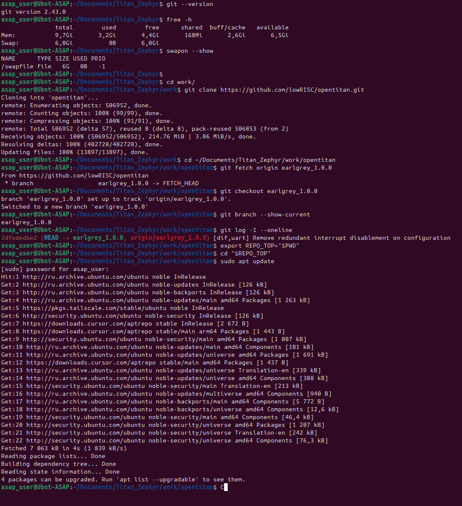
Команда `git clone` полностью копирует удаленный Git-репозиторий на локальный компьютер.

После загрузки был выполнен переход в каталог:

```bash
cd ~/Documents/Titan_Zephyr/work/opentitan
```

Затем была выбрана необходимая версия проекта:

```bash
git fetch origin earlgrey_1.0.0
git checkout earlgrey_1.0.0
```

Название `earlgrey_1.0.0` здесь является **техническим названием ветки в Git**, поэтому оно должно оставаться в команде.

Проверка выполнялась командой:

```bash
git branch --show-current
```

Результат:

```text
earlgrey_1.0.0
```

Также был проверен commit:

```bash
git log -1 --oneline
```

Результат:


*Рисунок 1 — Проверка ресурсов системы, клонирование репозитория и выбор версии OpenTitan*


То есть нужная версия репозитория действительно была выбрана.

### Что здесь произошло

После `git clone` мы получили исходный код проекта.

Но Git-репозиторий содержит множество различных состояний проекта.

Поэтому команда:

```bash
git checkout ...
```

переключила репозиторий именно на версию, необходимую для работы.

---

<a id="s06"></a>

## 6. Установка системных зависимостей

OpenTitan нельзя просто скачать и сразу запустить.

Для его сборки необходимы дополнительные программы и библиотеки.

Проект содержит специальный файл:

```text
apt-requirements.txt
```

В нем перечислены Linux-пакеты, необходимые для работы.

Для их установки была выполнена команда:

```bash
sed '/^#/d' ./apt-requirements.txt | xargs sudo apt install -y
```

### Что делает эта команда

Здесь сразу несколько операций.

Команда:

```bash
sed '/^#/d'
```

удаляет из файла строки-комментарии.

После этого:

```bash
xargs sudo apt install -y
```

передает полученный список пакетов команде `apt install`.


---

### 6.1. Ошибка `libncursesw5`

На этом этапе возникла первая проблема:

```text
E: Unable to locate package libncursesw5
```

То есть пакетный менеджер Ubuntu не смог найти пакет `libncursesw5`. Эта ошибка действительно присутствует в логах.

Для продолжения установки зависимость была заменена на:

```text
libncursesw6
```

Использовалась команда:

```bash
sed '/^#/d;/^$/d;s/^libncursesw5$/libncursesw6/' \
    ./apt-requirements.txt | xargs sudo apt install -y
```

В результате `libncursesw6` был найден и установлен.

### Что важно понять

Это не ошибка самого OpenTitan.

Проблема возникла из-за различия версий Linux-пакетов.

Проект ожидал старое имя библиотеки:

```text
libncursesw5
```

а используемая версия Ubuntu предоставляет более новую:

```text
libncursesw6
```

То есть потребовалась небольшая адаптация старой зависимости к новой Linux-системе.

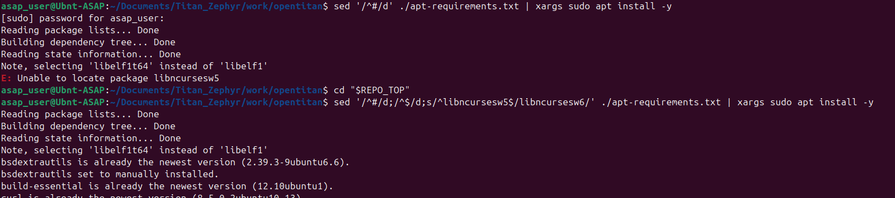


*Рисунок 2 — Установка системных зависимостей и обнаружение отсутствующего пакета libncursesw5*


<a id="s07"></a>

## 7. Создание Python-окружения

OpenTitan использует большое количество Python-инструментов.

Чтобы не устанавливать их глобально в систему, было создано виртуальное окружение:

```bash
python3 -m venv .venv
```

После этого оно активировалось:

```bash
source .venv/bin/activate
```

### Что такое `venv`

`venv` — изолированное Python-окружение.

Условно:

В Linux сохраняется системный Python, а в `.venv` находятся отдельные `pip`, Python-пакеты и зависимости OpenTitan.


Это позволяет установить нужные OpenTitan версии библиотек, не изменяя Python-пакеты всей операционной системы.

После активации окружения в терминале появился префикс:

```text
(.venv)
```

Это означает, что дальнейшие Python-команды выполняются внутри виртуального окружения.

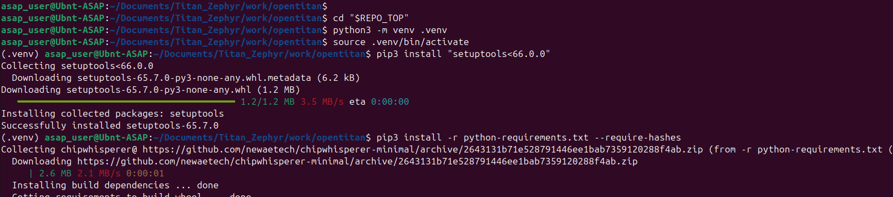


*Рисунок 3 — Создание Python-окружения OpenTitan и начало установки Python-зависимостей*


---

<a id="s08"></a>

## 8. Установка Python-зависимостей OpenTitan

Python-зависимости проекта устанавливались из файла:

```text
python-requirements.txt
```

Использовалась команда:

```bash
pip3 install -r python-requirements.txt --require-hashes
```

Здесь:

```text
-r
```

означает «установить пакеты из указанного файла».

Параметр:

```text
--require-hashes
```

заставляет `pip` проверять контрольные суммы пакетов.

Это позволяет убедиться, что устанавливаются именно ожидаемые версии зависимостей.

---

### 8.1. Проблема с setuptools

После установки появилась ошибка:

```text
AttributeError: module 'pkgutil' has no attribute 'ImpImporter'
```

Она возникала при попытке импортировать `setuptools` и `fusesoc`.

Проблема была решена обновлением `setuptools`:

```bash
pip install "setuptools>=68,<81"
```

После этого была установлена версия:

```text
setuptools 80.10.2
```

и проверка:

```bash
python3 -c "import setuptools, fusesoc; print('setuptools', setuptools.__version__); print('fusesoc ok')"
```

завершилась успешно:

```text
setuptools 80.10.2
fusesoc ok
```

Это подтверждается логами.

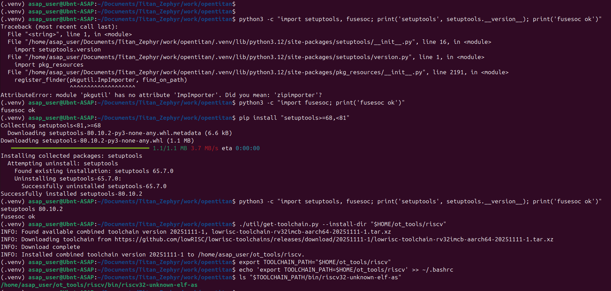

*Рисунок 4 — Исправление проблемы setuptools и проверка FuseSoC*


### Что такое FuseSoC

FuseSoC используется для организации и сборки HDL-проектов.

OpenTitan состоит из большого количества аппаратных модулей, и FuseSoC помогает правильно определить:

* какие SystemVerilog-файлы нужны;
* какие модули зависят друг от друга;
* в каком порядке их обрабатывать;
* какие параметры использовать при сборке.

---

<a id="s09"></a>

## 9. RISC-V toolchain

OpenTitan использует процессор архитектуры RISC-V.

Поэтому обычного компилятора Linux недостаточно.

Нужен **cross-compiler**, который выполняется на нашем компьютере, но создает программу для RISC-V.

Схема выглядит так:

Кросс-компилятор работает на компьютере x86-64 и создаёт RISC-V программу для OpenTitan.


Путь к инструментам был настроен следующим образом:

```bash
export TOOLCHAIN_PATH="$HOME/ot_tools/riscv"
export PATH="$TOOLCHAIN_PATH/bin:$PATH"
```

После установки в каталоге присутствовал, например:

```text
riscv32-unknown-elf-as
```

что подтверждает наличие RISC-V assembler.

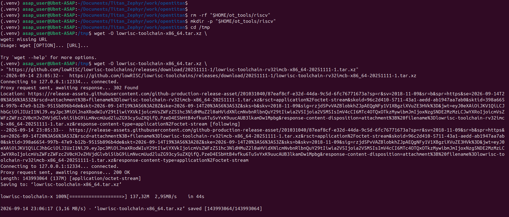


*Рисунок 5 — Загрузка RISC-V toolchain для сборки программ OpenTitan*


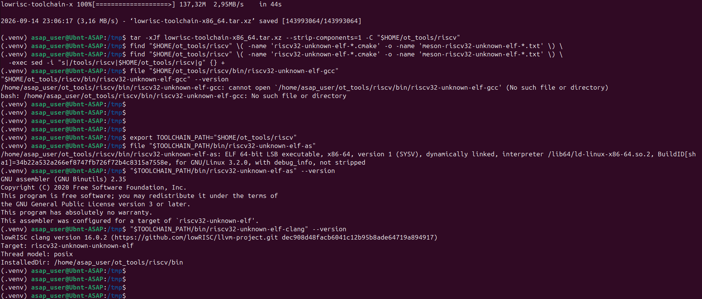

*Рисунок 6 — Настройка и проверка RISC-V toolchain*

---

<a id="s10"></a>

## 10. Установка Verilator

Следующим важным этапом была установка Verilator.

Для сборки использовались:

```bash
sudo apt install -y gcc-11 g++-11 autoconf flex bison
```


*Рисунок 7 — Установка компиляторов и системных зависимостей для сборки Verilator*

После этого был загружен исходный код Verilator и выбрана версия:

```bash
export VERILATOR_VERSION=4.210

git clone https://github.com/verilator/verilator.git
cd verilator

git checkout "v${VERILATOR_VERSION}"
```
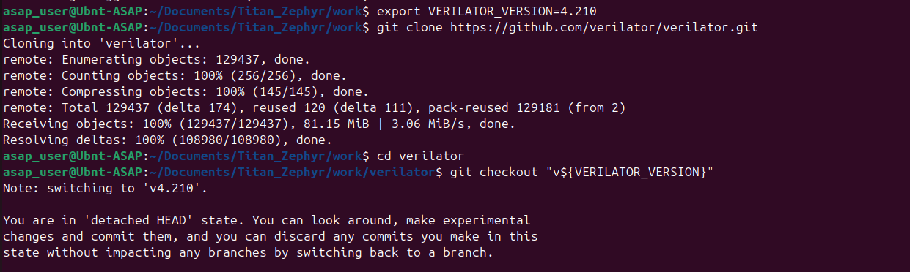

*Рисунок 8 — Клонирование исходного кода Verilator и выбор версии 4.210*


Затем была подготовлена конфигурация:

```bash
autoconf
```

После чего:

```bash
CC=gcc-11 CXX=g++-11 ./configure \
    --prefix=/tools/verilator/${VERILATOR_VERSION}
```
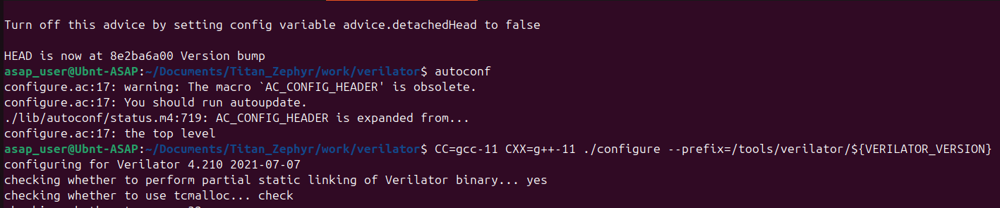

*Рисунок 9 — Конфигурирование исходного кода Verilator перед сборкой*


### Что означает `configure`

Команда `configure` подготавливает проект к сборке.

Параметр:

```text
--prefix=/tools/verilator/4.210
```

указывает каталог, куда Verilator должен быть установлен.

После этого выполнялась компиляция:

```bash
CC=gcc-11 CXX=g++-11 make -j2
```
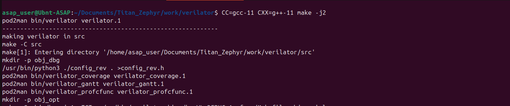

*Рисунок 10 — Процесс компиляции Verilator*

а затем установка:

```bash
sudo CC=gcc-11 CXX=g++-11 make install
```
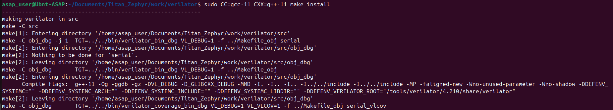

*Рисунок 11 — Завершение сборки и установка Verilator*

После установки исполняемый файл находился в:

```text
/tools/verilator/4.210/bin/verilator
```

и команда:

```bash
verilator --version
```

выдала:

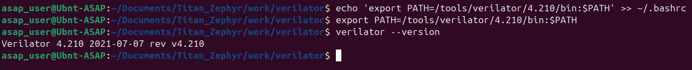

*Рисунок 12 — Проверка установленной версии Verilator 4.210*


То есть установка Verilator завершилась успешно.


---

<a id="s11"></a>

## 11. Как теперь связаны все компоненты

К этому моменту были подготовлены:

```text
OpenTitan
    +
Python-зависимости
    +
RISC-V toolchain
    +
Verilator
```

Их назначение можно представить следующим образом:

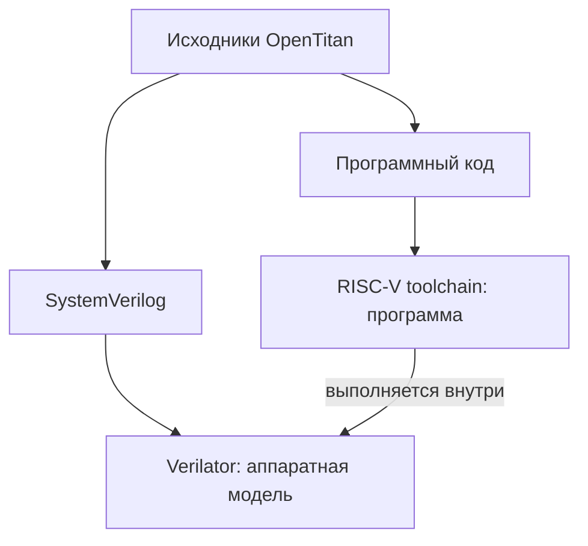


Таким образом Verilator отвечает за **аппаратную модель**, а RISC-V toolchain — за **программное обеспечение, выполняемое внутри этой модели**.

---

<a id="s12"></a>

## 12. Первый тест OpenTitan

Для проверки того, что вся цепочка работает, был запущен штатный тест:

```text
uart_smoketest
```

Команда запуска:

```bash
./bazelisk.sh test \
  --test_output=streamed \
  --jobs=1 \
  --local_resources=cpu=1 \
  --test_timeout=900 \
  //sw/device/tests:uart_smoketest_sim_verilator
```
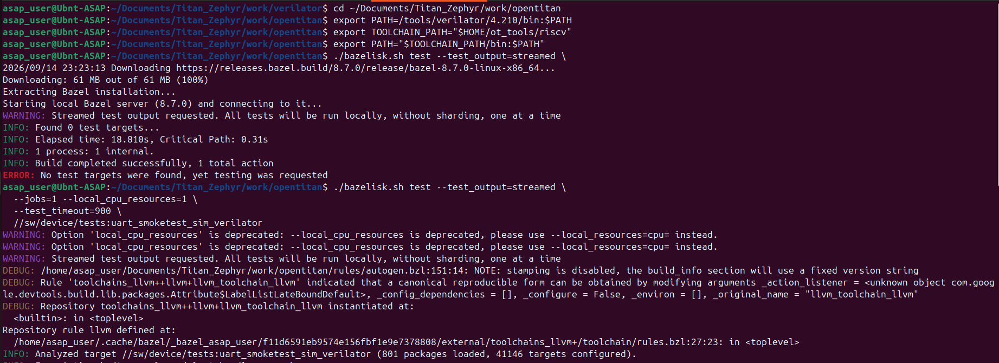

*Рисунок 13 — Запуск UART smoke test OpenTitan с помощью Bazel и Verilator*

---

### 12.1. Что такое Bazel и Bazelisk

OpenTitan использует систему сборки **Bazel**.

Bazel получает описание того, что необходимо собрать, находит все зависимости и выполняет необходимые операции.

`Bazelisk` — это вспомогательная утилита, позволяющая запускать подходящую версию Bazel.

В нашем случае цель:

```text
//sw/device/tests:uart_smoketest_sim_verilator
```

означает:

> собрать и выполнить UART smoke test с использованием Verilator.

---

### 12.2. Что проверяет UART smoke test

UART — это последовательный интерфейс передачи данных.

Именно через UART встроенные устройства часто выводят текстовые диагностические сообщения.

Smoke test — это базовая проверка:

> «Запускается ли система вообще и работают ли основные компоненты?»

То есть это не полный набор всех тестов OpenTitan.

Это быстрый тест, позволяющий убедиться, что модель:

* собирается;
* запускается;
* выполняет программу;
* может выводить данные через UART.

---

<a id="s13"></a>

## 13. Ошибка `libtinfo.so.5`

При первой попытке сборка теста завершилась ошибкой.

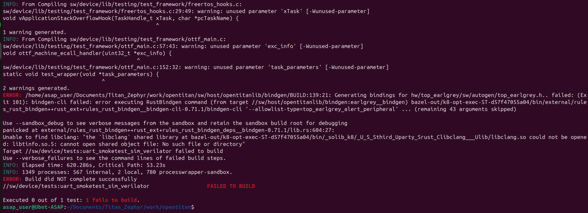

*Рисунок 14 — Ошибка сборки из-за отсутствия библиотеки libtinfo.so.5*


В логе присутствовало:

```text
Unable to find libclang

libclang.so could not be opened:
libtinfo.so.5: cannot open shared object file
```

После этого Bazel сообщил:

```text
Target //sw/device/tests:uart_smoketest_sim_verilator failed to build
```

То есть проблема была не в логике теста, а в отсутствующей системной библиотеке.

После установки совместимой библиотеки `libtinfo5` тест был запущен повторно.

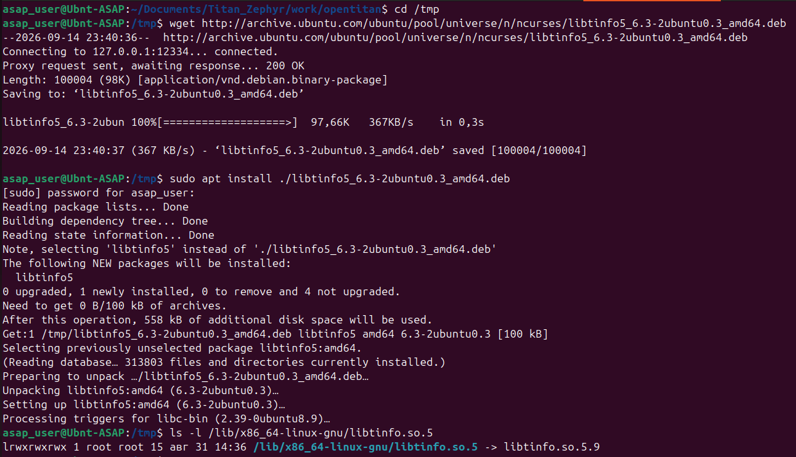

*Рисунок 15 — Установка библиотеки libtinfo5 для устранения ошибки сборки*

---

<a id="s14"></a>

## 14. Успешный результат теста OpenTitan

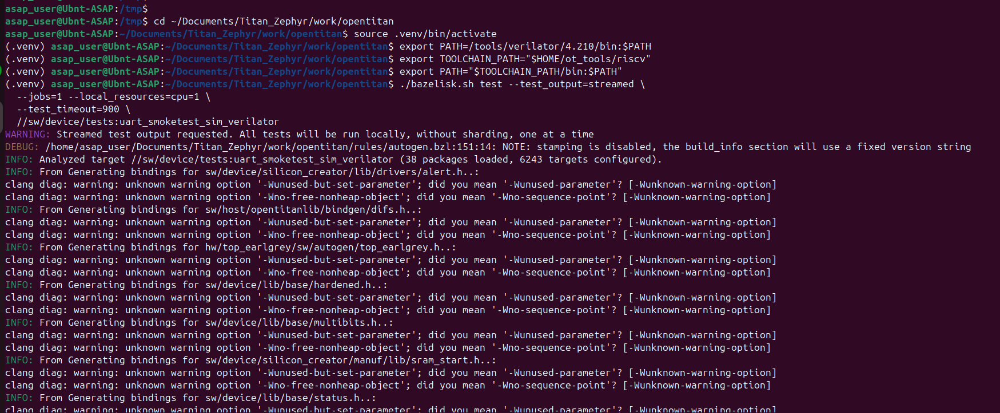

*Рисунок 16 — Повторная сборка и выполнение UART smoke test после устранения ошибки*


При повторном запуске появился следующий вывод:

```text
Test ROM complete, jumping to flash

Running sw/device/tests/uart_smoketest.c

Enabling OTTF alert catcher

Finished sw/device/tests/uart_smoketest.c

PASS!
```

Особенно важная строка:

```text
PASS!
```

Она означает, что тест успешно завершился.

Bazel дополнительно вывел:

```text
//sw/device/tests:uart_smoketest_sim_verilator PASSED in 89.4s

Executed 1 out of 1 test: 1 test passes.
```
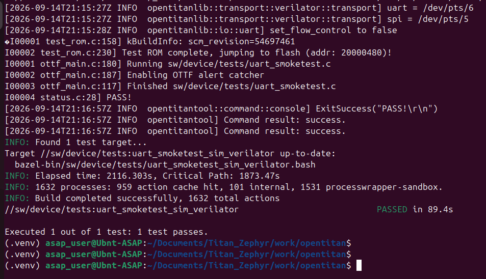


*Рисунок 17 — Успешное выполнение UART smoke test: PASS*


То есть был запущен один тест и он успешно прошел.

### Что мы доказали этим тестом

Полученный результат означает, что:

Исходники были собраны, модель Verilator запустилась, тестовое ПО загрузилось и выполнило обмен через UART. Тест сообщил `PASS!`.


Именно поэтому `PASS!` является важным результатом первой части работы.

---

<a id="s15"></a>

## 15. Установка Zephyr RTOS

После успешной проверки OpenTitan следующим этапом стала установка Zephyr.

Zephyr — это **операционная система реального времени**, или RTOS.

RTOS расшифровывается как:

```text
Real-Time Operating System
```

Такие операционные системы обычно используются во встроенных устройствах и микроконтроллерах.

В отличие от обычного Linux, Zephyr рассчитан на устройства:

* с небольшим объемом RAM;
* с ограниченной Flash-памятью;
* без жесткого диска;
* с небольшими микроконтроллерами.

---

<a id="s16"></a>

## 16. Создание отдельного окружения Zephyr

Для Zephyr было создано отдельное Python-окружение:

```bash
cd ~/Documents/Titan_Zephyr/work

python3 -m venv .venv-zephyr

source .venv-zephyr/bin/activate
```

Это отдельное окружение от OpenTitan:

```text
.venv
    → Python-пакеты OpenTitan

.venv-zephyr
    → Python-пакеты Zephyr
```

Это удобно, потому что зависимости двух проектов не мешают друг другу.

После этого были установлены:

```bash
pip install -U pip west
```
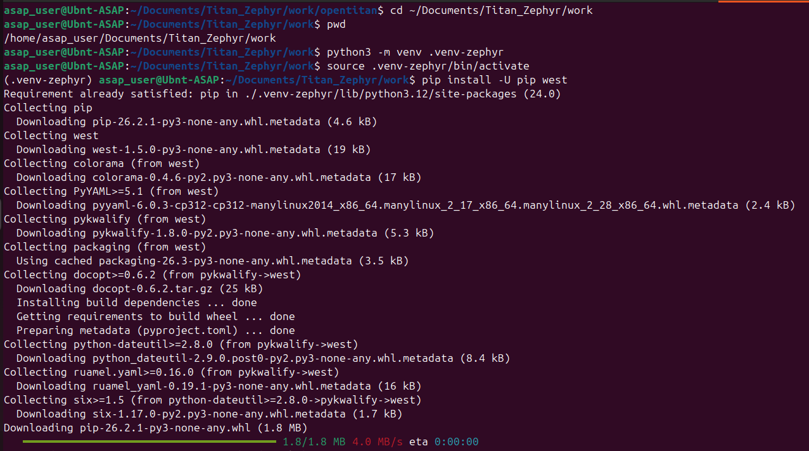


*Рисунок 18 — Создание Python-окружения Zephyr и установка инструмента west*

---

<a id="s17"></a>

## 17. Что такое `west`

`west` — основной инструмент управления проектами Zephyr.

Его можно условно сравнить с командным центром Zephyr.

Через него выполняются:

* создание workspace;
* получение модулей;
* обновление зависимостей;
* сборка программы.

---

<a id="s18"></a>

## 18. Получение Zephyr 3.7.0

Workspace был создан командой:

```bash
west init \
  -m https://github.com/zephyrproject-rtos/zephyr \
  --mr v3.7.0 \
  zephyrproject
```
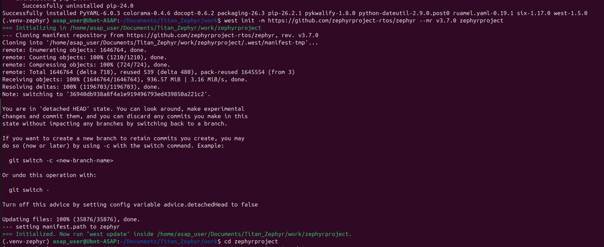

*Рисунок 19 — Инициализация рабочего пространства Zephyr 3.7.0*


Здесь:

```text
-m
```

указывает Git-репозиторий Zephyr.

А:

```text
--mr v3.7.0
```

означает, что необходимо использовать Zephyr версии **3.7.0**.

Затем:

```bash
cd zephyrproject
west update
```
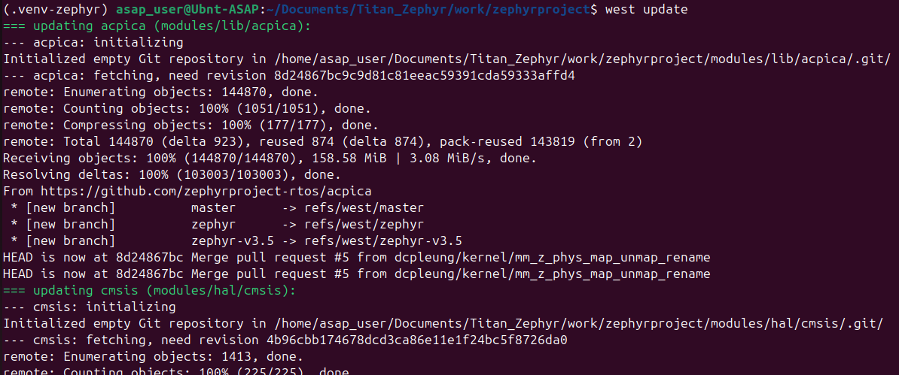

*Рисунок 20 — Загрузка модулей и зависимостей Zephyr с помощью west*


Команда `west update` загружает все модули, которые необходимы Zephyr.

---

### 18.1. Ошибка `hal_nxp`

Во время загрузки модулей одна из попыток завершилась сообщением:

```text
ERROR: update failed for project hal_nxp
```
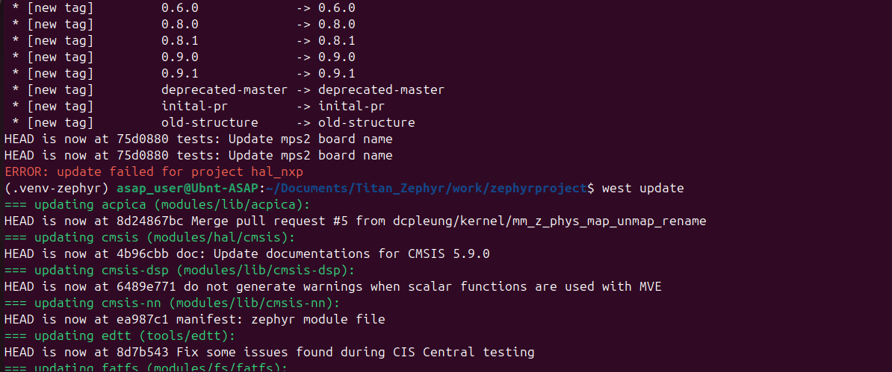

*Рисунок 21 — Ошибка загрузки модуля hal_nxp при выполнении west update*


То есть один из дополнительных репозиториев не загрузился с первого раза.

После повторной загрузки модуль был получен, и процесс обновления продолжился.

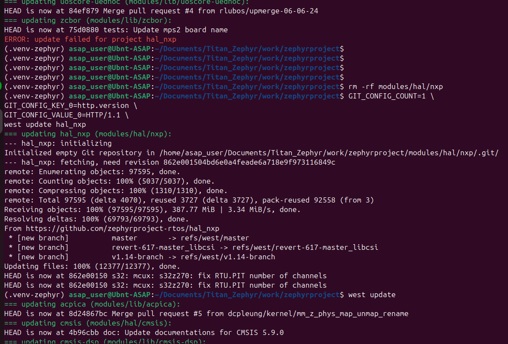


*Рисунок 22 — Повторная загрузка hal_nxp и продолжение обновления модулей Zephyr*


---

<a id="s19"></a>

## 19. Python-зависимости Zephyr

Была предпринята попытка выполнить:

```bash
west packages pip --install
```

Однако `west` ответил:

```text
west: unknown command "packages"
```
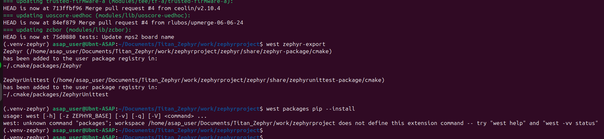


*Рисунок 23 — Экспорт Zephyr и ошибка команды west packages pip --install*


Поэтому Python-зависимости были установлены напрямую:

```bash
pip install -r zephyr/scripts/requirements-base.txt
```
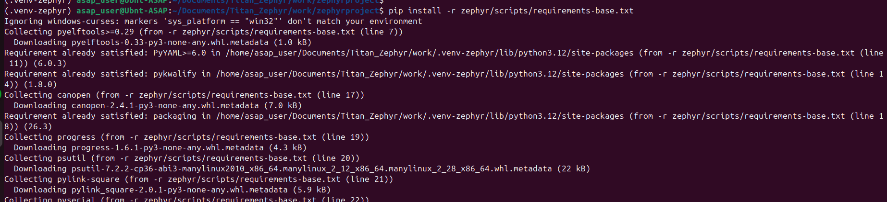


*Рисунок 24 — Установка Python-зависимостей Zephyr из requirements-base.txt*


Это зафиксировано в логах.

---

<a id="s20"></a>

## 20. Установка Zephyr SDK

Одних исходников Zephyr недостаточно.

Для компиляции программ под нужную архитектуру необходим Zephyr SDK.

Использовалась версия:

```text
Zephyr SDK 0.16.8
```

Архив SDK был распакован в:

```text
~/ot_tools/zephyr-sdk-0.16.8
```

После этого была выполнена команда:

```bash
./setup.sh -t riscv64-zephyr-elf -h -c
```

В процессе установки появилось:

```text
Zephyr SDK 0.16.8 Setup

Installing 'riscv64-zephyr-elf' toolchain ...

Installing host tools ...

All done.
```

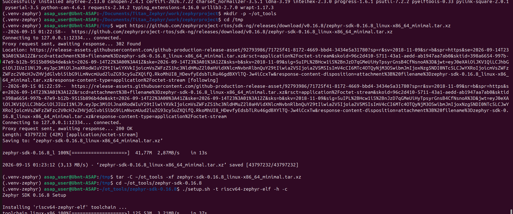


*Рисунок 25 — Загрузка и установка Zephyr SDK 0.16.8 и RISC-V toolchain*


То есть SDK и RISC-V toolchain для Zephyr были успешно установлены.

---

<a id="s21"></a>

## 21. Сборка Zephyr Hello World

Теперь имелись:

```text
OpenTitan
+
Verilator
+
Zephyr
+
Zephyr SDK
```

Поэтому можно было собрать стандартное приложение Zephyr:

```text
samples/hello_world
```

Команда:

```bash
west build \
    -b opentitan_earlgrey \
    samples/hello_world \
    --pristine
```
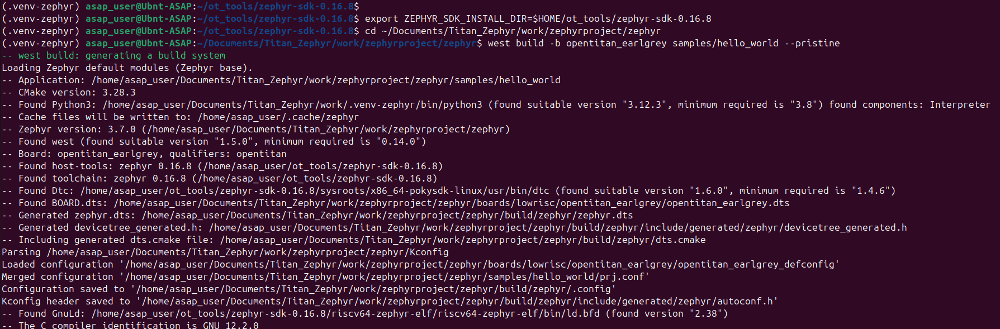


*Рисунок 26 — Конфигурирование сборки приложения Hello World для OpenTitan*


Название `opentitan_earlgrey` здесь является техническим идентификатором платы внутри Zephyr. Его необходимо оставить в команде, потому что именно под это имя Zephyr содержит конфигурацию OpenTitan.

### Разберем команду

```text
west build
```

означает «собрать приложение».

```text
-b
```

означает «выбрать целевую плату».

```text
samples/hello_world
```

указывает, какое приложение необходимо собрать.

```text
--pristine
```

означает выполнить чистую сборку, то есть не использовать старые результаты предыдущих сборок.

---

<a id="s22"></a>

## 22. Результат сборки Zephyr

Во время конфигурации Zephyr сообщил:

```text
Zephyr version: 3.7.0
```

Также был найден:

```text
Zephyr SDK 0.16.8
```

и компилятор:

```text
GNU 12.2.0
```

После сборки появилась строка:

```text
[103/103] Linking C executable zephyr/zephyr.elf
```

Это означает, что все 103 этапа сборки завершились и был создан исполняемый файл:

```text
zephyr.elf
```

В логе также указано использование памяти:

```text
ROM: 14436 B / 1 MB   1.38%
RAM:  4208 B / 64 KB  6.42%
```

То есть программа использует примерно:

* 14.4 KB постоянной памяти;
* 4.2 KB оперативной памяти.

Сборка и эти значения присутствуют в логах.

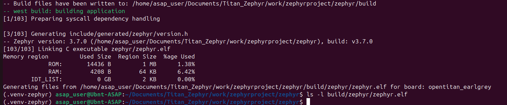


*Рисунок 27 — Успешная сборка Zephyr Hello World и использование памяти ROM и RAM*


---

<a id="s23"></a>

## 23. Что такое файл `zephyr.elf`

После компиляции появился:

```text
build/zephyr/zephyr.elf
```

ELF — это формат исполняемого файла.

В данном случае внутри него находится программа:

```text
Zephyr RTOS
+
Hello World
```

скомпилированная для запуска на OpenTitan.

То есть этот файл аналогичен обычной программе, только он предназначен не для запуска непосредственно в Linux.

Его необходимо загрузить в память моделируемого устройства.

---

<a id="s24"></a>

## 24. Запуск Zephyr в модели OpenTitan

Для запуска использовалась модель, ранее созданная при сборке OpenTitan.

Сначала была задана переменная:

```bash
OT=~/Documents/Titan_Zephyr/work/opentitan
```

Затем находился исполняемый файл симулятора:

```bash
SIM=$(find "$OT/bazel-bin" \
    "$HOME/.cache/bazel" \
    -name Vchip_sim_tb -type f 2>/dev/null | head -1)
```

После этого задавались три важных файла:

```bash
ROM=$OT/bazel-bin/sw/device/lib/testing/test_rom/test_rom_sim_verilator.39.scr.vmem

OTP=$OT/bazel-bin/hw/ip/otp_ctrl/data/img_rma.24.vmem

ELF=$PWD/build/zephyr/zephyr.elf
```

---

<a id="s25"></a>

## 25. Что такое ROM, OTP и Flash

Для понимания запуска важно разобраться в этих трех областях.

### ROM

ROM содержит начальный загрузочный код.

При запуске процессор начинает выполнение именно с ROM.

Упрощенно:

После включения выполнение начинается с ROM, где расположен код начальной загрузки.


---

### OTP

OTP означает:

```text
One-Time Programmable
```

Это область памяти, предназначенная для хранения важных параметров устройства.

В реальном защищенном микроконтроллере такая память может содержать различные постоянные настройки и данные безопасности.

---

### Flash

Flash — основная память, в которую загружается программа.

В нашем случае в нее загружался:

```text
zephyr.elf
```

Поэтому последовательность запуска выглядела примерно так:

Код ROM передаёт управление программе во Flash; затем запускается Zephyr и приложение `Hello World`.


---

<a id="s26"></a>

## 26. Запуск Verilator

Симулятор был запущен командой:

```bash
"$SIM" --verbose-mem-load \
  --meminit=rom,"$ROM" \
  --meminit=otp,"$OTP" \
  --meminit=flash0,"$ELF"
```

Параметр:

```text
--meminit
```

означает предварительную загрузку содержимого в указанную область памяти.

То есть:

| Область модели | Загружаемый образ |
| --- | --- |
| `rom` | Test ROM |
| `otp` | OTP image |
| `flash0` | Zephyr ELF |


Лог действительно показывает загрузку ROM, OTP и `zephyr.elf` в `flash0`.

---

<a id="s27"></a>

## 27. Работа UART

После запуска модели Verilator создал виртуальный UART.

В логе появилось:

```text
UART: Created /dev/pts/8 for uart0.
UART: Additionally writing all UART output to 'uart0.log'.
```

Таким образом, весь текст, который виртуальное устройство отправляет через UART, записывался в:

```text
uart0.log
```

Это позволяет просматривать вывод точно так же, как если бы мы подключились к последовательному порту настоящего микроконтроллера.

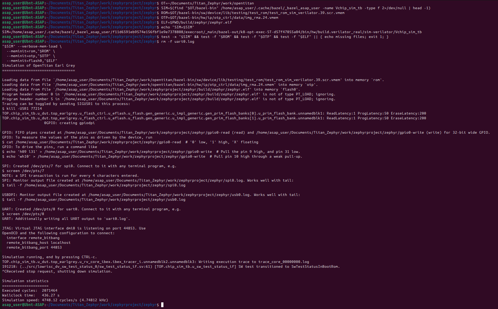


*Рисунок 28 — Загрузка ROM, OTP и Zephyr ELF в модель OpenTitan и запуск симуляции*


---

<a id="s28"></a>

## 28. Просмотр UART

Для просмотра вывода использовалась команда:

```bash
tail -f uart0.log
```

Команда `tail -f` показывает конец файла и продолжает следить за ним.

Если в файл появляются новые строки, они сразу отображаются в терминале.

То есть:

Виртуальный OpenTitan выводит сообщения через UART в `uart0.log`; команда `tail -f` показывает новые строки в терминале.


---

<a id="s29"></a>

## 29. Финальный результат — Hello World

В UART был получен следующий вывод:

```text
I00001 test_rom.c:158] kBuildInfo: scm_revision=54697461
I00002 test_rom.c:230] Test ROM complete, jumping to flash (addr: 20000404)!
*** Booting Zephyr OS build v3.7.0 ***
Hello World! opentitan_earlgrey/opentitan
```
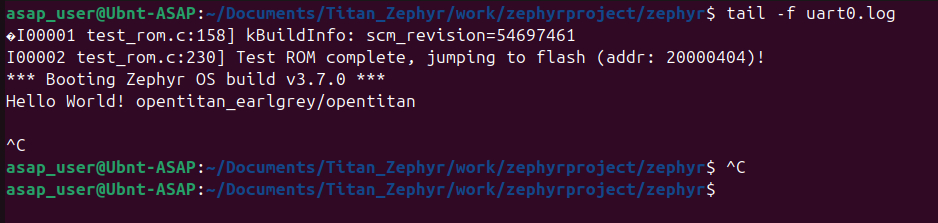


*Рисунок 29 — Успешная загрузка Zephyr RTOS и выполнение приложения Hello World*


Этот результат является главным подтверждением успешного выполнения второй части задания.

Разберем его построчно.

---

### 29.1. Выполнение Test ROM

Строка:

```text
Test ROM complete, jumping to flash
```

означает, что первоначальный код из ROM успешно выполнился.

После этого управление передается программе во Flash.

---

### 29.2. Запуск Zephyr

Следующая строка:

```text
*** Booting Zephyr OS build v3.7.0 ***
```

означает, что управление успешно перешло к Zephyr.

То есть операционная система действительно начала работу.

---

### 29.3. Выполнение Hello World

Последняя строка:

```text
Hello World! opentitan_earlgrey/opentitan
```

означает, что стандартное приложение Zephyr `Hello World` было успешно выполнено.

Таким образом была подтверждена вся цепочка:

В модели OpenTitan под Verilator код Test ROM передал управление программе во Flash. Zephyr запустил `Hello World`, а вывод приложения появился в UART-журнале `uart0.log`.


---

<a id="s30"></a>

## 30. Основные возникшие проблемы и их решение

Во время работы были обнаружены проблемы совместимости различных версий программного обеспечения.

| Проблема                                        | Причина / смысл                                                | Решение                                            |
| ----------------------------------------------- | -------------------------------------------------------------- | -------------------------------------------------- |
| `libncursesw5` не найден                        | В используемой Ubuntu отсутствует старое имя пакета            | Использован `libncursesw6`                         |
| Ошибка `pkgutil.ImpImporter`                    | Старый `setuptools` оказался несовместим с используемым Python | `setuptools` обновлен до 80.10.2                   |
| Требовалась подходящая версия Verilator         | OpenTitan собирался с конкретным набором инструментов          | Собран Verilator 4.210                             |
| `libtinfo.so.5` отсутствовал                    | `libclang` зависел от этой библиотеки                          | Установлена совместимая библиотека                 |
| `west update` не загрузил `hal_nxp`             | Ошибка при загрузке внешнего Zephyr-модуля                     | Модуль был загружен повторно                       |
| `west packages pip --install` не поддерживалась | Команда отсутствовала в используемой конфигурации `west`       | Использован `pip install -r requirements-base.txt` |

Эти проблемы являются нормальной частью работы со сложным программно-аппаратным проектом, который включает множество внешних инструментов и зависимостей.

---


<a id="s31"></a>

## 31. Заключение

В рамках работы было подготовлено Linux-окружение для сборки и программного моделирования OpenTitan.

Сначала был получен исходный код необходимой версии OpenTitan и установлены системные и Python-зависимости.

Для моделирования аппаратной части был собран и установлен **Verilator 4.210**.

После настройки RISC-V toolchain был выполнен штатный тест OpenTitan:

```text
uart_smoketest
```

Тест завершился сообщением:

```text
PASS!
```

что подтвердило успешную сборку и работу модели OpenTitan в Verilator.

На следующем этапе была установлена операционная система реального времени **Zephyr RTOS версии 3.7.0** и **Zephyr SDK 0.16.8**.

С помощью Zephyr было собрано стандартное приложение:

```text
samples/hello_world
```

Результатом сборки стал исполняемый файл:

```text
zephyr.elf
```

который был загружен в Flash-память модели OpenTitan.

После запуска модели через Verilator первоначально выполнился Test ROM, затем управление было передано Zephyr.

В UART был получен следующий вывод:

```text
*** Booting Zephyr OS build v3.7.0 ***
Hello World! opentitan_earlgrey/opentitan
```

Таким образом, в ходе работы была успешно проверена возможность запуска программного обеспечения на модели OpenTitan, а также подтверждена возможность запуска Zephyr RTOS и тестового приложения `Hello World`.

---


[К списку практических работ](../../README.md)
