# Практическая работа №02 · UART-сервис эхо-повтора

[Все работы](../../README.md) · [Подготовка окружения](../01-environment/README.md)


## Содержание

- [Цель работы](#section-1)
- [Задание](#section-2)
- [Среда выполнения](#section-3)
- [Ход работы](#section-4)
- [Порядок повторного запуска](#section-5)
- [Вывод](#section-6)

<a id="section-1"></a>

## 1. Цель работы

Разработать эхо-сервис на Zephyr RTOS и хост-клиент для проверки обмена данными через UART на платформе OpenTitan Earlgrey в симуляции Verilator. Проверить сборку приложения, запуск Zephyr, возврат отправленных байтов и завершение сервиса по команде `EXIT`.

<a id="section-2"></a>

## 2. Задание

Сервис получает UART из Device Tree через `DT_CHOSEN(zephyr_console)`, проверяет готовность устройства и в цикле принимает байты с помощью `uart_poll_in()`. Каждый принятый байт сразу возвращается через `uart_poll_out()`. Клиент подключается к последовательному порту, отправляет тестовую строку, сравнивает ответ с исходными данными и проверяет команду завершения.

<a id="section-3"></a>

## 3. Среда выполнения

Работа выполнена на Linux-хосте `Ubnt-ASAP`. Доступ к нему осуществлялся из терминала рабочей станции. Версии ниже приведены по сохранённому журналу сборки.

| Компонент | Значение |
| --- | --- |
| Zephyr RTOS | 3.7.0 |
| Плата | opentitan_earlgrey |
| Zephyr SDK | 0.16.8 |
| west | 1.5.0 |
| CMake | 3.28.3 |
| Python сборки | 3.12.3 |
| pySerial | 3.5 |
| Модель оборудования | OpenTitan Earlgrey, Verilator |
| UART в выполненном запуске | /dev/pts/2 |
| Параметры клиента | 115200 бод, 8 бит, без чётности, 1 стоп-бит |

Хост-клиент работает с PTY, созданным симулятором. Номер `/dev/pts/2` относится к сохранённому запуску и при повторном запуске может измениться.

<a id="section-4"></a>

## 4. Ход работы

### 4.1. Подготовка проекта

Было активировано виртуальное окружение и создан каталог приложения:

```bash
cd ~/Documents/Titan_Zephyr/work
source .venv-zephyr/bin/activate
cd zephyrproject/zephyr
mkdir -p samples/echo_service/src
```

Состав проекта:

```text
samples/echo_service/
    CMakeLists.txt
    prj.conf
    src/main.c
    host_client.py
    results/
        echo_service.elf
        uart0_echo.log
```

### 4.2. Сборочный файл и конфигурация

Файл `CMakeLists.txt` подключает Zephyr и исходный код приложения:

```cmake
cmake_minimum_required(VERSION 3.20.0)
find_package(Zephyr REQUIRED HINTS $ENV{ZEPHYR_BASE})
project(echo_service)
target_sources(app PRIVATE src/main.c)
```

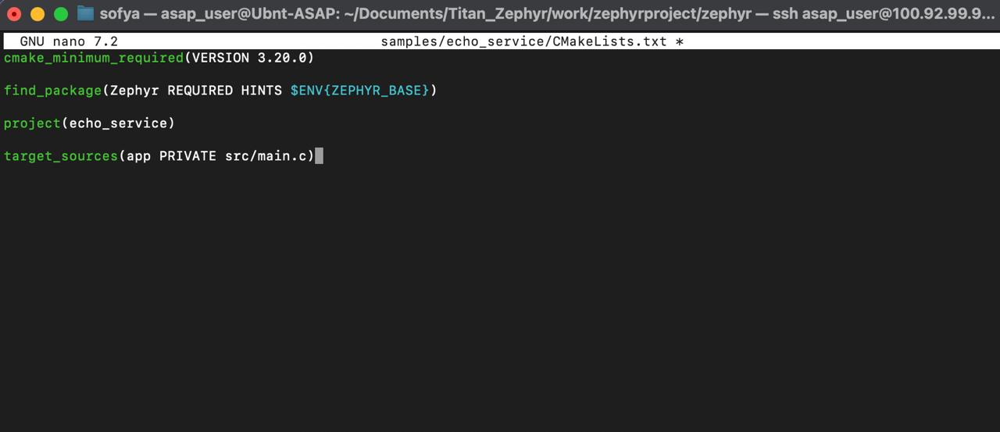

*Рисунок 1 — файл CMakeLists.txt*

В реализованном проекте необходимые параметры включены явно в `prj.conf`:

```ini
CONFIG_SERIAL=y
CONFIG_CONSOLE=y
CONFIG_UART_CONSOLE=y
CONFIG_PRINTK=y
```

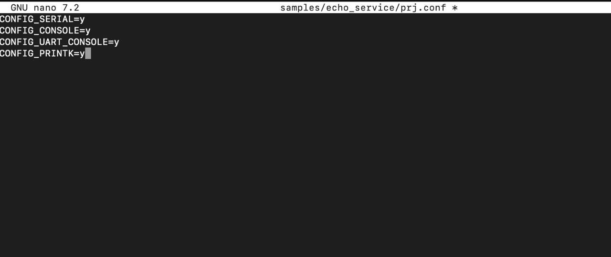

*Рисунок 2 — конфигурация Zephyr*

### 4.3. Реализация сервиса

UART определяется выражением `DEVICE_DT_GET(DT_CHOSEN(zephyr_console))`. Если `device_is_ready()` возвращает ложное значение, приложение выводит ошибку и возвращает код 1. После успешной инициализации сервис выводит приветствие и маркер `READY`.

В основном цикле отсутствие байта приводит к повторному опросу UART. При получении байта сервис немедленно возвращает его, затем анализирует команду. Буфер размером 32 байта используется только для распознавания `EXIT`, поэтому длинная строка продолжает передаваться обратно даже после переполнения командного буфера.

Команда завершения распознаётся только как отдельная строка `EXIT` в верхнем регистре. Конец строки может задаваться `\n` или `\r`. Для обычных строк последовательность `\r\n` не создаёт второй отдельной команды. При `EXIT\r\n` цикл завершается уже на `\r`, поэтому эхо последующего `\n` не гарантируется.

После команды сервис отправляет `OK:BYE`, выходит из цикла и выводит `Echo service stopped.`. Возврат из `main()` завершает поток приложения, но сам по себе не останавливает Zephyr или процесс Verilator.

Исходный код `src/main.c`:

```c
#include <zephyr/kernel.h>
#include <zephyr/device.h>
#include <zephyr/devicetree.h>
#include <zephyr/drivers/uart.h>
#include <zephyr/sys/printk.h>

#include <stdbool.h>
#include <stddef.h>
#include <string.h>

#define UART_DEVICE DEVICE_DT_GET(DT_CHOSEN(zephyr_console))

#define CMD_BUF_SIZE 32

static void uart_send_string(const struct device *dev, const char *str)
{
    while (*str != '\0') {
        uart_poll_out(dev, (unsigned char)*str);
        str++;
    }
}

static bool is_exit_command(const char *buf, size_t len)
{
    return len == 4 && memcmp(buf, "EXIT", 4) == 0;
}

int main(void)
{
    const struct device *uart = UART_DEVICE;

    unsigned char c;

    char cmd_buf[CMD_BUF_SIZE];
    size_t cmd_len = 0;

    bool overflow = false;
    bool previous_was_cr = false;

    if (!device_is_ready(uart)) {
        printk("UART device not ready!\r\n");
        return 1;
    }

    printk("\r\n");
    printk("=== OpenTitan Zephyr UART Echo Service ===\r\n");
    printk("UART ready.\r\n");
    printk("Send data and it will be echoed back.\r\n");
    printk("Type EXIT and press Enter to stop.\r\n");
    printk("READY\r\n");

    while (1) {

        if (uart_poll_in(uart, &c) != 0) {
            continue;
        }

        /*
         * Echo:
         * получили байт -> сразу отправили обратно
         */
        uart_poll_out(uart, c);

        /*
         * Обрабатываем Enter:
         * \n, \r и \r\n.
         */
        if (c == '\r' || c == '\n') {

            if (c == '\n' && previous_was_cr) {
                previous_was_cr = false;
                continue;
            }

            if (!overflow &&
                is_exit_command(cmd_buf, cmd_len)) {

                uart_send_string(uart, "\r\nOK:BYE\r\n");
                break;
            }

            cmd_len = 0;
            overflow = false;
            previous_was_cr = (c == '\r');

            continue;
        }

        previous_was_cr = false;

        /*
         * Буфер нужен только для распознавания EXIT.
         * Сам echo работает независимо от буфера.
         */
        if (!overflow) {

            if (cmd_len < CMD_BUF_SIZE) {
                cmd_buf[cmd_len] = (char)c;
                cmd_len++;
            } else {
                overflow = true;
            }
        }
    }

    printk("Echo service stopped.\r\n");

    return 0;
}
```

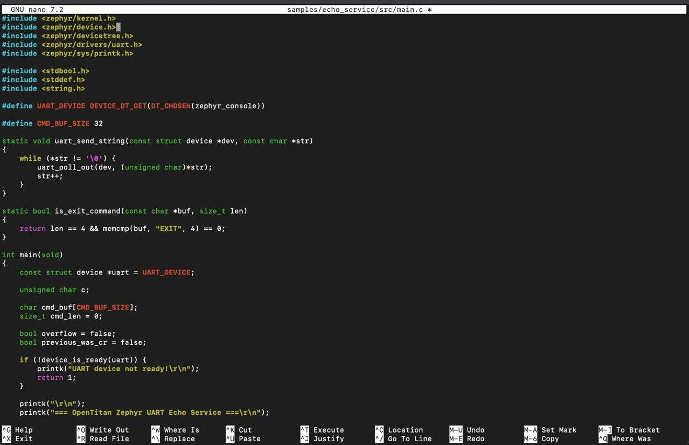

*Рисунок 3 — выбор UART и подготовка сервиса*

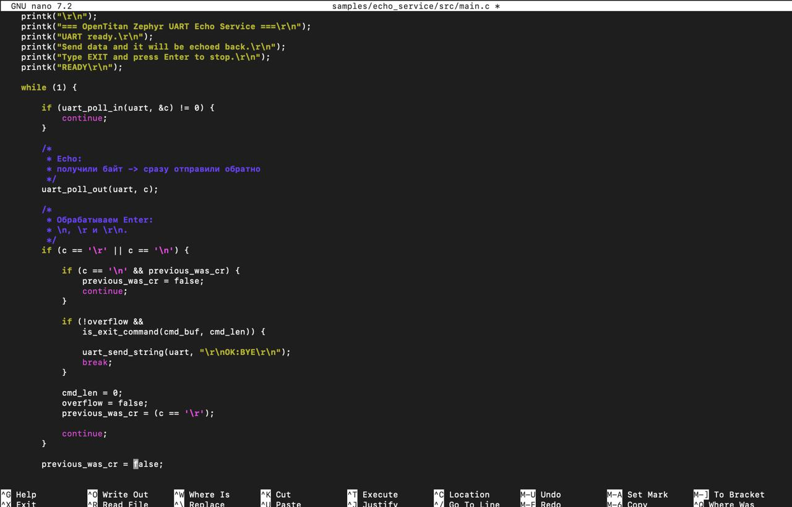

*Рисунок 4 — приём байтов и немедленный эхо-повтор*

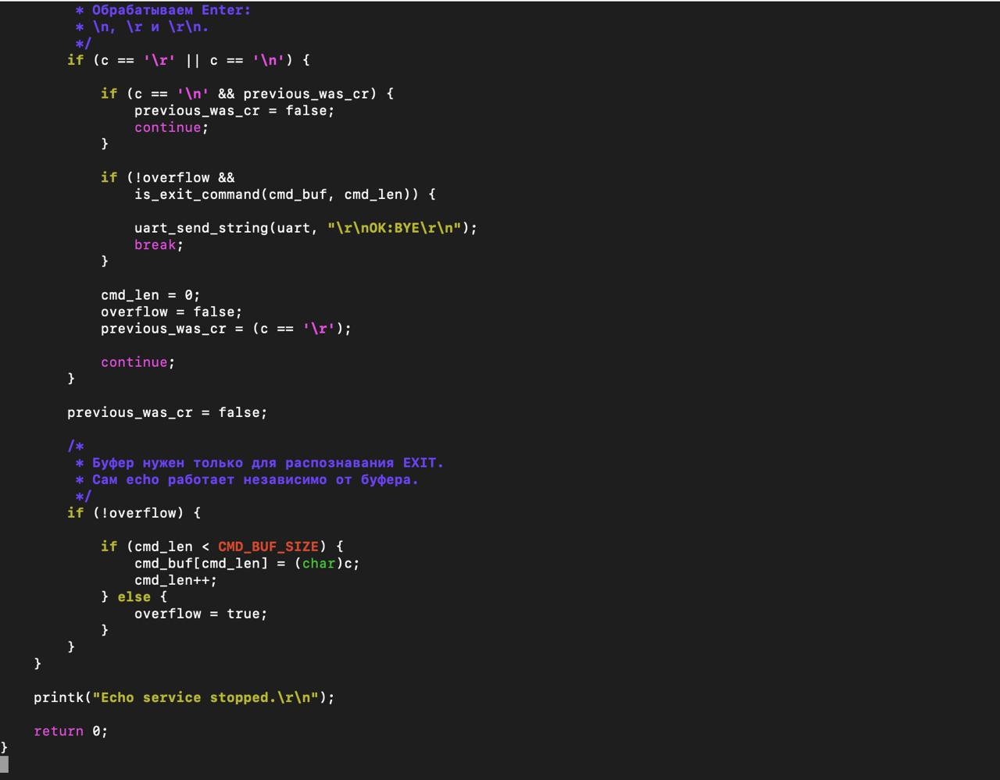

*Рисунок 5 — распознавание EXIT и обработка переполнения*

### 4.4. Сборка приложения

Из каталога Zephyr была выполнена команда:

```bash
west build -b opentitan_earlgrey samples/echo_service --pristine \
    -DCMAKE_EXPORT_COMPILE_COMMANDS=ON
```

Сборка завершилась этапом `[103/103] Linking C executable zephyr/zephyr.elf`. Создан файл `build/zephyr/zephyr.elf`.

| Область | Использовано | Доступно | Доля |
| --- | ---: | ---: | ---: |
| ROM | 14 876 Б | 1 МБ | 1,42% |
| RAM | 4 208 Б | 64 КБ | 6,42% |

Эти значения отражают размещение образа по отчёту линкера. Они не являются измерением динамического расхода памяти во время выполнения. Размер ELF-файла около 303 КБ также не равен объёму занятой ROM.

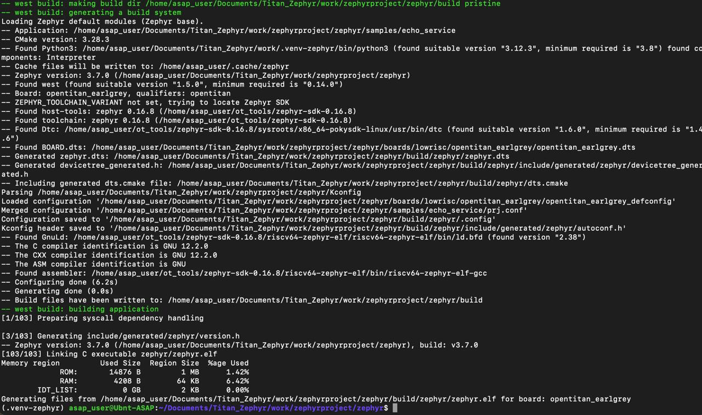

*Рисунок 6 — успешная сборка приложения и отчёт об использовании памяти*

### 4.5. Запуск в Verilator

В журнале использованы уже подготовленные симулятор и образы ROM/OTP. Для повторения запуска в той же среде:

```bash
OT=~/Documents/Titan_Zephyr/work/opentitan
SIM=$(find "$OT/bazel-bin" "$HOME/.cache/bazel/_bazel_$(whoami)" \
    -name Vchip_sim_tb -type f 2>/dev/null | head -1)
ROM=$OT/bazel-bin/sw/device/lib/testing/test_rom/test_rom_sim_verilator.39.scr.vmem
OTP=$OT/bazel-bin/hw/ip/otp_ctrl/data/img_rma.24.vmem
ELF=$PWD/build/zephyr/zephyr.elf

test -f "$SIM" && echo "SIM OK"
test -f "$ROM" && echo "ROM OK"
test -f "$OTP" && echo "OTP OK"
test -f "$ELF" && echo "ELF OK"

"$SIM" --verbose-mem-load \
    --meminit=rom,"$ROM" \
    --meminit=otp,"$OTP" \
    --meminit=flash0,"$ELF"
```

Названия образов относятся к использованной сборке OpenTitan. Симулятор создал UART-порт `/dev/pts/2` и журнал `uart0.log`.

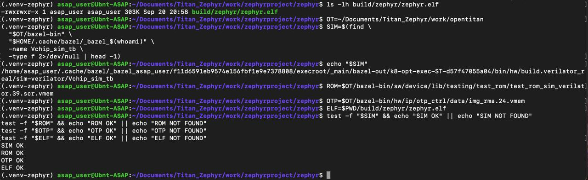

*Рисунок 7 — поиск симулятора и проверка образов*

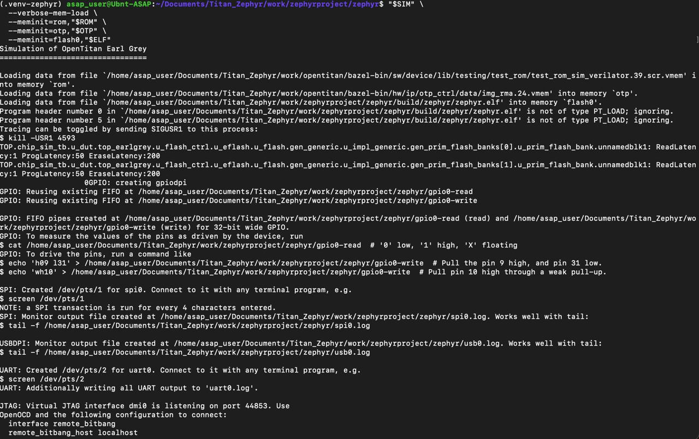

*Рисунок 8 — запуск Verilator и создание UART PTY*

В другом терминале проверялся журнал UART:

```bash
cd ~/Documents/Titan_Zephyr/work/zephyrproject/zephyr
tail -f uart0.log
```

После сообщений Test ROM появились загрузочная строка Zephyr 3.7.0, приветствие эхо-сервиса, `UART ready.` и `READY`.

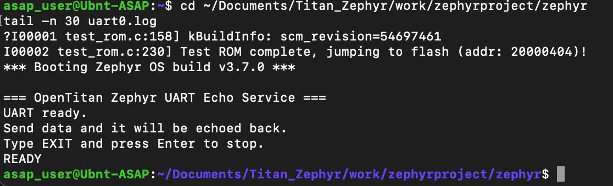

*Рисунок 9 — успешная загрузка Zephyr и готовность сервиса*

### 4.6. Отладка доступа к порту

При подключении через `screen` обнаружилась ранее созданная отсоединённая сессия. Её просмотр и закрытие выполнялись командами:

```bash
screen -ls
screen -r 5671
# Для закрытия конкретной сессии:
screen -S 5671 -X quit
fuser /dev/pts/2
```

Идентификатор 5671 относится к выполненной работе. Команда `stty -F /dev/pts/2 raw -echo` возвращала `Device or resource busy`. Это сообщение приведено как этап отладки, а не как подтверждение настройки порта. В итоговом тесте порт открывал Python-клиент. Перед запуском клиента терминальную программу следует закрыть, чтобы исключить конкурирующее чтение.

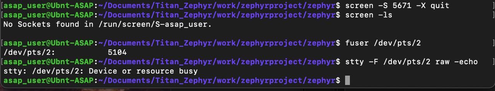

*Рисунок 10 — закрытие screen и диагностика занятости PTY*

### 4.7. Реализация хост-клиента

Клиент написан на Python с использованием pySerial. Он принимает имя порта через аргумент командной строки и открывает его с параметрами 115200 8N1. В начале клиент удаляет накопленные сообщения загрузки из входного буфера.

Функция `read_exact()` собирает ответ из нескольких чтений до получения требуемого количества байтов или истечения тайм-аута 5 секунд. Это позволяет корректно обработать ответ, поступающий частями.

Первый тест отправляет `b"HELLO OPENTITAN ZEPHYR\r\n"` и сравнивает ответ побайтно. Второй отправляет `b"EXIT\n"` и ожидает маркер `OK:BYE`. При несовпадении эхо клиент возвращает код 2, при отсутствии подтверждения EXIT — код 3, при успехе — код 0.

```python
#!/usr/bin/env python3

import sys
import time
import serial


def read_exact(ser, count, timeout=5.0):
    data = bytearray()
    end_time = time.time() + timeout

    while len(data) < count and time.time() < end_time:
        chunk = ser.read(count - len(data))
        if chunk:
            data.extend(chunk)

    return bytes(data)


def main():
    if len(sys.argv) != 2:
        print(f"Usage: {sys.argv[0]} /dev/pts/N")
        return 1

    port = sys.argv[1]

    print("=== OpenTitan Zephyr UART Echo Client ===")
    print(f"Port: {port}")
    print("Mode: 115200 8N1")

    ser = serial.Serial(
        port=port,
        baudrate=115200,
        bytesize=serial.EIGHTBITS,
        parity=serial.PARITY_NONE,
        stopbits=serial.STOPBITS_ONE,
        timeout=0.2
    )

    time.sleep(0.2)

    # Удаляем старые сообщения загрузки Zephyr
    ser.reset_input_buffer()

    # -------------------------
    # Тест Echo
    # -------------------------

    test_data = b"HELLO OPENTITAN ZEPHYR\r\n"

    print()
    print("--- ECHO TEST ---")
    print(f"TX: {test_data!r}")

    ser.write(test_data)
    ser.flush()

    received = read_exact(ser, len(test_data))

    print(f"RX: {received!r}")

    if received == test_data:
        print("RESULT: PASS")
    else:
        print("RESULT: FAIL")
        print("TX HEX:", test_data.hex(" "))
        print("RX HEX:", received.hex(" "))
        ser.close()
        return 2

    # -------------------------
    # Проверка EXIT
    # -------------------------

    print()
    print("--- EXIT TEST ---")

    exit_command = b"EXIT\n"

    print(f"TX: {exit_command!r}")

    ser.write(exit_command)
    ser.flush()

    response = bytearray()
    end_time = time.time() + 5

    while time.time() < end_time:
        data = ser.read(1)

        if data:
            response.extend(data)

        if b"OK:BYE" in response:
            break

    print(f"RX: {bytes(response)!r}")

    if b"OK:BYE" in response:
        print("EXIT: PASS")
    else:
        print("EXIT: FAIL")
        ser.close()
        return 3

    ser.close()

    print()
    print("========================")
    print("ALL TESTS PASSED")
    print("========================")

    return 0


if __name__ == "__main__":
    sys.exit(main())
```

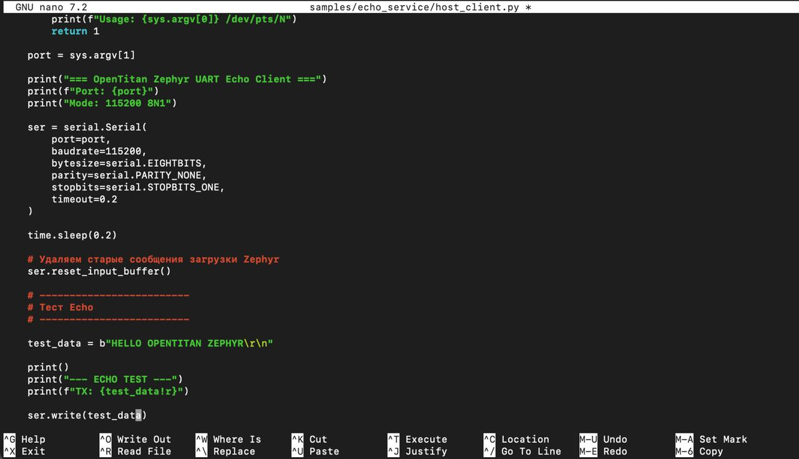

*Рисунок 11 — параметры порта и отправка тестовой строки*

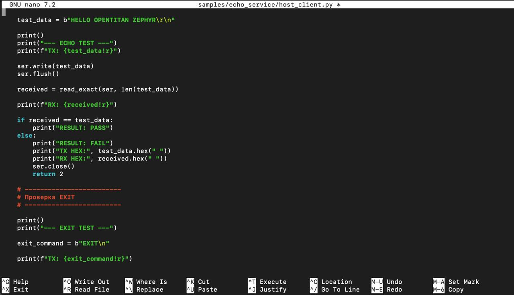

*Рисунок 12 — сравнение отправленных и полученных данных*

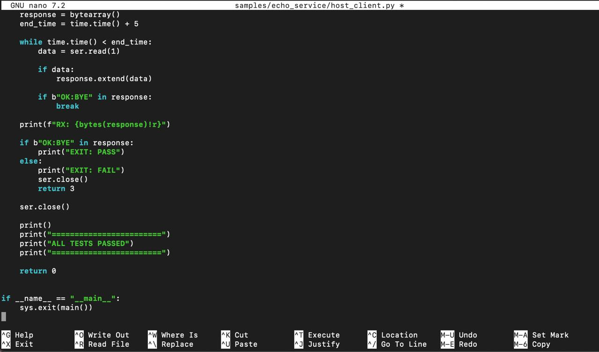

*Рисунок 13 — проверка подтверждения EXIT*

### 4.8. Проверка работы

После появления `READY` был запущен клиент:

```bash
python3 samples/echo_service/host_client.py /dev/pts/2
```

Результат из журнала выполненной работы:

```text
--- ECHO TEST ---
TX: b'HELLO OPENTITAN ZEPHYR\r\n'
RX: b'HELLO OPENTITAN ZEPHYR\r\n'
RESULT: PASS

--- EXIT TEST ---
TX: b'EXIT\n'
RX: b'EXIT\n\r\nOK:BYE'
EXIT: PASS

ALL TESTS PASSED
```

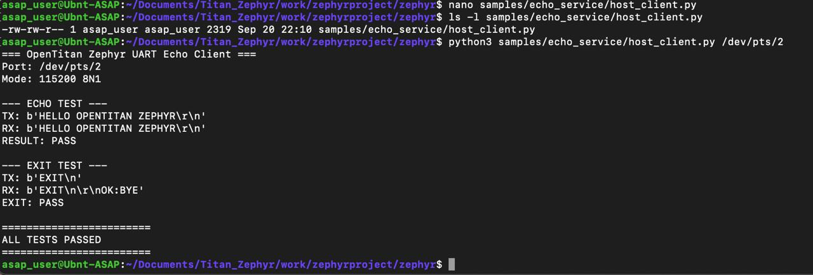

*Рисунок 14 — успешное выполнение тестов ECHO и EXIT*

| Проверка | Наблюдаемый результат | Вывод |
| --- | --- | --- |
| Сборка для opentitan_earlgrey | zephyr.elf сформирован | Сборка успешна |
| Готовность UART | UART ready., READY | Инициализация успешна |
| Эхо строки с CRLF | TX и RX совпали, RESULT: PASS | Тестовая строка возвращена без изменений |
| Команда EXIT с LF | Ответ содержит OK:BYE, EXIT: PASS | Команда распознана |
| Итог клиента | ALL TESTS PASSED | Обе автоматические проверки пройдены |

В выполненном тесте проверена одна строка и команда `EXIT\n`. Длительный поток, все значения байтов, строка длиннее 32 байт и отдельные тесты `EXIT\r`/`EXIT\r\n` в предоставленных результатах отсутствуют. Поэтому успешный тест подтверждает корректность проверенного обмена, но не доказывает отсутствие потерь при любой скорости передачи.

### 4.9. Сохранение результатов

В выполненной среде были сохранены UART-журнал и ELF-образ:

```bash
mkdir -p samples/echo_service/results
cp uart0.log samples/echo_service/results/uart0_echo.log
cp build/zephyr/zephyr.elf samples/echo_service/results/echo_service.elf
ls -lh samples/echo_service/results
```

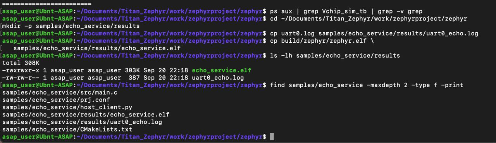

*Рисунок 15 — сохранение артефактов и итоговая структура проекта*

<a id="section-5"></a>

## 5. Порядок повторного запуска

1. Активировать виртуальное окружение и перейти в каталог Zephyr.
2. Собрать приложение командой `west build` из раздела 4.4.
3. Проверить пути к симулятору и образам ROM/OTP, затем запустить Verilator.
4. Найти созданный UART PTY в выводе симулятора. Дождаться `READY` в `uart0.log`.
5. Закрыть `screen`, если он подключён к этому PTY.
6. Запустить `host_client.py` с актуальным именем порта.
7. Убедиться, что клиент вывел `RESULT: PASS`, `EXIT: PASS`, `ALL TESTS PASSED`.
8. После EXIT перезапустить симуляцию перед новым тестом. Для остановки процесса симулятора использовать `Ctrl+C` в его терминале.

<a id="section-6"></a>

## 6. Вывод

В ходе работы разработаны UART-сервис эхо-повтора на языке C для Zephyr RTOS и Python-клиент для автоматической проверки. Приложение успешно собрано для `opentitan_earlgrey` и запущено в Verilator. Через PTY `/dev/pts/2` клиент получил тестовую строку без изменений и подтверждение команды EXIT. Сохранённые результаты подтверждают работоспособность цепочки взаимодействия Linux-хоста, симулятора OpenTitan, UART-драйвера Zephyr и приложения для выполненных тестов.

---

[К списку практических работ](../../README.md)
