# Практическая работа №03 · UART-сервис генерации ключевого материала

[Все работы](../../README.md) · [Подготовка окружения](../01-environment/README.md)


## Содержание

- [Цель работы](#section-1)
- [Исследовательская часть: выбор криптографической подсистемы](#section-2)
- [Среда выполнения](#section-3)
- [Ход выполнения](#section-4)
- [Соответствие заданию и границы результата](#section-5)
- [Порядок повторного запуска](#section-6)
- [Вывод](#section-7)
- [Источники](#section-8)

<a id="section-1"></a>

## 1. Цель работы

Разработать сервис генерации 32-байтового ключевого материала с использованием PSA Crypto API и хост-клиент для обмена командами через UART. Исследовать выбор криптографического API Zephyr, обработать недоступность энтропии в симуляции OpenTitan Earlgrey и проверить формат ответов.

<a id="section-2"></a>

## 2. Исследовательская часть: выбор криптографической подсистемы

### 2.1. Доступные подходы

PSA Crypto — стандартизированный интерфейс криптографических операций, разработанный Arm в рамках Platform Security Architecture. Он отделяет код приложения от конкретной реализации криптографии. В Zephyr 3.7.0 реализация PSA Crypto использует Mbed TLS [1]. Поэтому PSA Crypto и Mbed TLS нельзя считать полностью независимыми библиотеками: в этой конфигурации PSA является интерфейсом, а Mbed TLS — его реализацией.

PSA предоставляет операции с ключами и криптографические примитивы для шифрования, вычисления хешей, MAC, подписей и согласования ключей. Набор доступных алгоритмов зависит от выбранной реализации и параметров сборки. В данной работе используются только инициализация библиотеки и получение случайных байтов. Наличие PSA API само по себе не означает, что все операции выполняются аппаратно.

TinyCrypt — компактная библиотека с ограниченным набором криптографических примитивов. Она ориентирована на устройства с небольшими ресурсами. Intel прекратил поддержку исходного проекта, его репозиторий архивирован в марте 2024 года [5]. Это снижает привлекательность исходного TinyCrypt для нового проекта, хотя в конкретной ветке Zephyr может использоваться поддерживаемая производная версия.

Прямое использование API Mbed TLS даёт доступ к функциям самой библиотеки. Приложение при этом зависит от её интерфейсов и настроек. PSA упрощает перенос приложения между поставщиками криптографических операций. Руководство миграции Zephyr 3.7 рекомендует PSA как дальнейшее направление развития [2].

### 2.2. Сравнение подходов

Таблица представляет качественную оценку для этой работы. Отдельные сопоставимые сборки TinyCrypt и прямого Mbed TLS не выполнялись.

| Критерий | PSA Crypto через Mbed TLS | TinyCrypt | Прямой API Mbed TLS |
| --- | --- | --- | --- |
| Интеграция | Единые функции `psa_*`, настройка поставщика и RNG через Kconfig | Подключение необходимых примитивов и RNG | Настройка модулей и вызовы `mbedtls_*` |
| Flash/RAM | Зависит от алгоритмов, управления ключами и RNG | Компактный набор примитивов, точные размеры не измерены | Зависит от включённых модулей, точные размеры не измерены |
| Документация | Спецификация PSA и документация Zephyr | Документация и заголовки проекта, исходный проект архивирован | Документация Mbed TLS и интеграции Zephyr |
| Аппаратное ускорение | Через поддерживаемые реализации и драйверы | Зависит от порта, единой модели PSA нет | Через механизмы конкретного порта и конфигурации |
| Пригодность для работы | Выбранный интерфейс | Не выбран | Используется как основа PSA, без прямых криптовызовов |

Нельзя по одному названию API определить, какой вариант занимает меньше памяти. Для количественного сравнения нужны одинаковая плата, одинаковый набор операций и отдельные сборки. В этой работе измерен только размер итогового приложения по отчёту линкера.

### 2.3. Энтропия и генерация случайных байтов

Источником исходной энтропии служит поддерживаемое платформой устройство либо специально интегрированный источник. Драйверный Entropy API снабжает подсистему случайных чисел и криптографические службы исходными данными [4]. `CONFIG_ENTROPY_GENERATOR` включает соответствующую подсистему, но не создаёт отсутствующее устройство и не гарантирует автоматическую замену аппаратной энтропии безопасной программной.

Программный CSPRNG может выдавать криптографически стойкие байты, если получает достаточно качественной энтропии. Программная реализация генератора и источник энтропии — разные части системы. Обычный `sys_rand_get()` не гарантирует криптографическую стойкость. `CONFIG_TEST_RANDOM_GENERATOR` и `CONFIG_TIMER_RANDOM_GENERATOR` предназначены для тестирования [3].

В выполненном запуске Verilator `psa_crypto_init()` вернул `-148`. По спецификации PSA это `PSA_ERROR_INSUFFICIENT_ENTROPY`, то есть недостаток энтропии [6]. Этот результат показывает проблему выбранной конфигурации симуляции. Он не доказывает, что аппаратный RNG OpenTitan недоступен во всех моделях и версиях Zephyr.

Для реального оборудования необходимы рабочий источник энтропии, его драйвер и подключение к поставщику PSA RNG. Следует проверить Device Tree, итоговую `.config` и успешность PSA-вызовов. Сохранить прикладной интерфейс `psa_generate_random()` возможно, но наличие аппаратного RNG не обеспечивает его автоматическое использование без подходящей интеграции.

### 2.4. Обоснование выбора

Для сервиса выбран PSA Crypto: единый интерфейс соответствует задаче и позволяет сохранить прикладные вызовы при изменении криптографического поставщика. Mbed TLS подключается средствами Zephyr, поэтому вручную добавлять исходники библиотеки в проект не требуется. При этом конфигурация зависит от версии Zephyr. В использованной версии 3.7.0 параметр `CONFIG_PSA_CRYPTO=y` из задания не распознался, поэтому применены доступные настройки Mbed TLS PSA.

В симуляции для продолжения проверки UART был явно реализован тестовый fallback. Он обеспечивает доступность протокола, но не заменяет безопасный источник случайных чисел. Для настоящих AES-256 ключей эта ветвь должна быть отключена, а отказ криптографического RNG должен приводить к ошибке генерации.

<a id="section-3"></a>

## 3. Среда выполнения

| Компонент | Значение |
| --- | --- |
| Linux-хост | Ubnt-ASAP, пользователь asap_user |
| Zephyr | 3.7.0 |
| Zephyr SDK | 0.16.8 |
| west | 1.5.0 |
| CMake | 3.28.3 |
| Python сборки | 3.12.3 |
| Плата | opentitan_earlgrey |
| Симулятор | Verilator, Vchip_sim_tb |
| Хост-клиент | Python, pySerial |
| Порт итогового теста | /dev/pts/4 |
| Параметры порта | 115200 бод, 8N1 |

Версия pySerial на скриншотах этой работы не показана. Номер PTY относится к итоговому запуску и может измениться при повторном запуске.

<a id="section-4"></a>

## 4. Ход выполнения

### 4.1. Создание проекта

Было активировано окружение и создан каталог сервиса:

```bash
cd ~/Documents/Titan_Zephyr/work
source .venv-zephyr/bin/activate
cd zephyrproject/zephyr
mkdir -p samples/keygen_service/src
```

Основные файлы проекта: `CMakeLists.txt`, `prj.conf`, `src/main.c` и `host_client.py`.

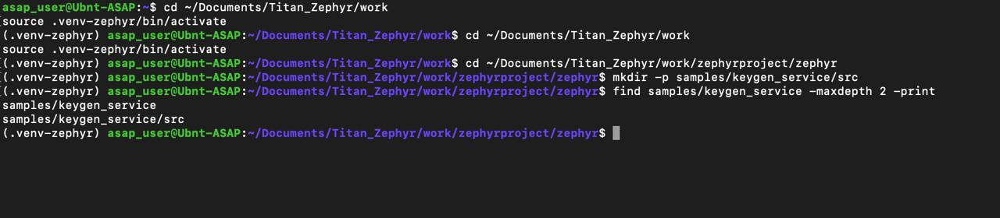

*Рисунок 1 — Подготовка каталога keygen_service*

Файл `CMakeLists.txt`:

```cmake
cmake_minimum_required(VERSION 3.20.0)
find_package(Zephyr REQUIRED HINTS $ENV{ZEPHYR_BASE})
project(keygen_service)
target_sources(app PRIVATE src/main.c)
```

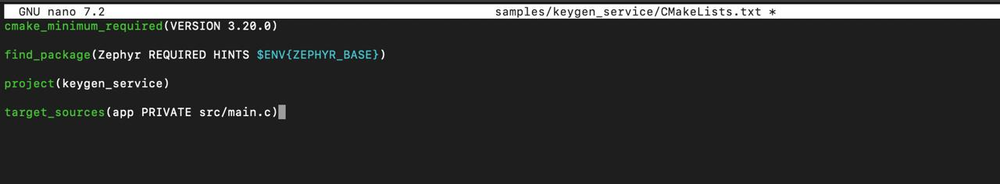

*Рисунок 2 — Сборочный файл приложения*

### 4.2. Исправление конфигурации PSA

Первоначально использовались параметры из задания: `CONFIG_PSA_CRYPTO=y` и `CONFIG_ENTROPY_GENERATOR=y`. Первая сборка завершилась предупреждением о неопределённом символе `PSA_CRYPTO` и остановкой Kconfig.

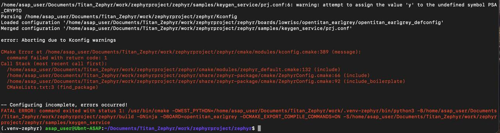

*Рисунок 3 — Ошибка сборки из-за неизвестного параметра PSA_CRYPTO*

Для Zephyr 3.7.0 были включены `CONFIG_MBEDTLS`, `CONFIG_MBEDTLS_PSA_CRYPTO_C` и `CONFIG_MBEDTLS_PSA_CRYPTO_LEGACY_RNG`. Сервис собрался, однако после запуска инициализация PSA завершилась ошибкой `-148`.

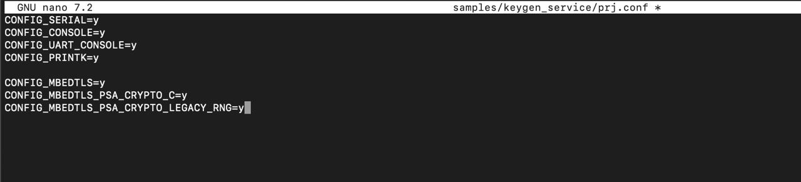

*Рисунок 4 — Подключение PSA через настройки Mbed TLS*

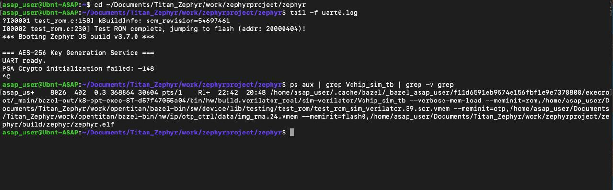

*Рисунок 5 — Ошибка инициализации PSA Crypto в первоначальном запуске*

Для проверки протокола в симуляции конфигурация была дополнена тестовым RNG. Итоговый `prj.conf` по скриншоту:

```ini
CONFIG_SERIAL=y
CONFIG_CONSOLE=y
CONFIG_UART_CONSOLE=y
CONFIG_PRINTK=y

CONFIG_MBEDTLS=y
CONFIG_MBEDTLS_PSA_CRYPTO_C=y
CONFIG_MBEDTLS_PSA_CRYPTO_LEGACY_RNG=y

# Программный RNG только для симуляции Verilator
CONFIG_TEST_RANDOM_GENERATOR=y
CONFIG_TIMER_RANDOM_GENERATOR=y
```

Это конфигурация выполненного учебного запуска. Две последние настройки не обеспечивают безопасную генерацию настоящих ключей. Во время сборки Zephyr прямо предупреждает о тестовом характере таймерного генератора.

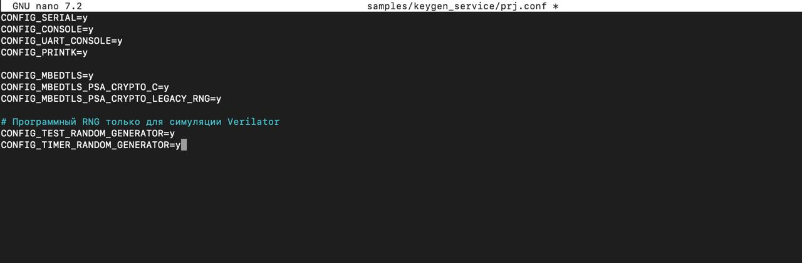

*Рисунок 6 — Итоговая конфигурация с тестовым RNG для Verilator*

### 4.3. Реализация UART и приёма команд

UART получается через `DEVICE_DT_GET(DT_CHOSEN(zephyr_console))`. Перед началом работы проверяется `device_is_ready()`. Сервис использует `uart_poll_in()` для приёма символов и `uart_poll_out()` для отправки строк.

В итоговом коде определены размеры:

```c
#define CMD_BUF_SIZE 64
#define AES256_KEY_BYTES 32
#define AES256_KEY_HEX_LEN (AES256_KEY_BYTES * 2)
```

Функция `uart_read_line()` читает до `\n` или `\r`. Буфер вмещает 63 символа и завершающий ноль. Если команда длиннее, сервис дочитывает строку, не записывая лишние символы, и возвращает `-1`. Основной цикл отвечает `ERR:CMD_TOO_LONG`. Пустая строка игнорируется, поэтому оставшийся `\n` после `\r` не становится неизвестной командой.

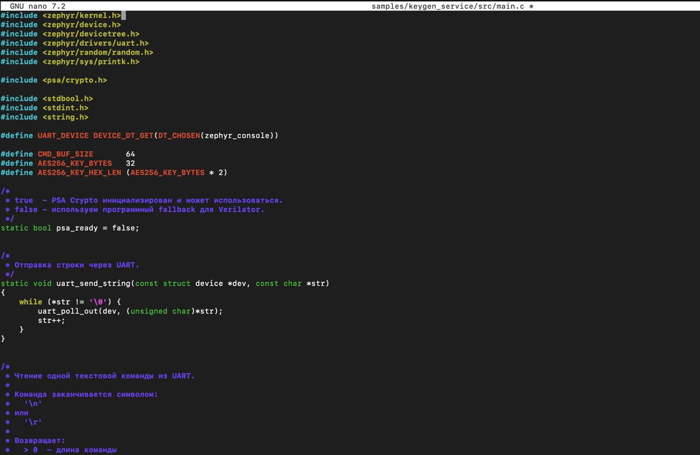

*Рисунок 7 — Объявления, размеры буферов и отправка строк через UART*

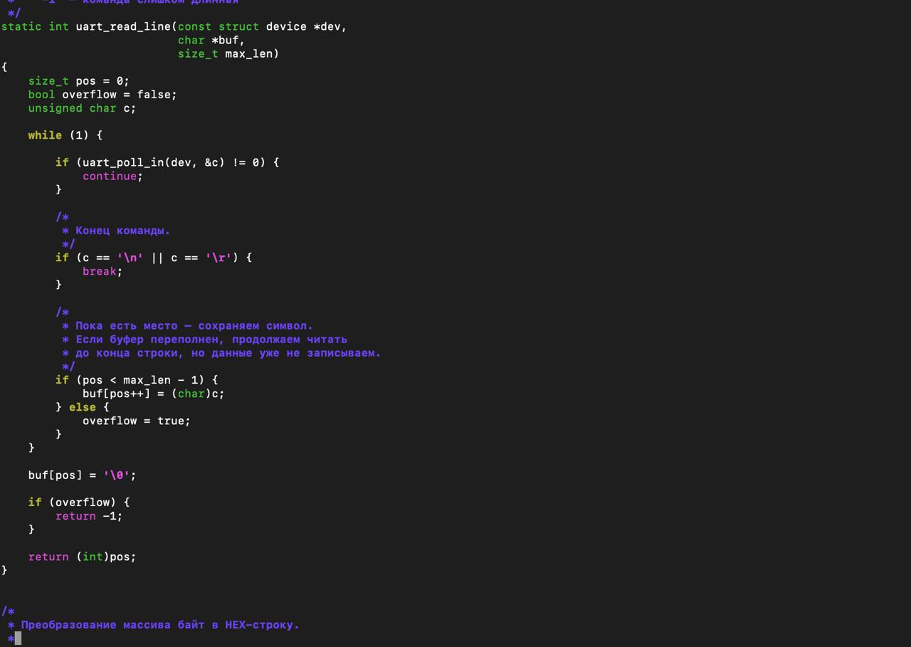

*Рисунок 8 — Приём строки и защита от переполнения буфера*

### 4.4. Генерация 32 байт и fallback

После `psa_crypto_init()` флаг `psa_ready` показывает доступность основного пути. При успешной инициализации используется `psa_generate_random(key, AES256_KEY_BYTES)`. Если вызов генерации возвращает ошибку, сервис выводит диагностику, сбрасывает флаг и переходит к тестовому источнику. Если PSA не инициализировался, тестовый путь используется сразу.

Ключевые вызовы, показанные в коде:

```c
psa_status_t status = psa_generate_random(key, AES256_KEY_BYTES);
/* При недоступности PSA в учебной симуляции: */
sys_rand_get(key, AES256_KEY_BYTES);
```

Fallback реализован в коде приложения. Это не автоматическое безопасное переключение Zephyr. В итоговом запуске использован именно `sys_rand_get()`, потому что инициализация PSA завершилась ошибкой.

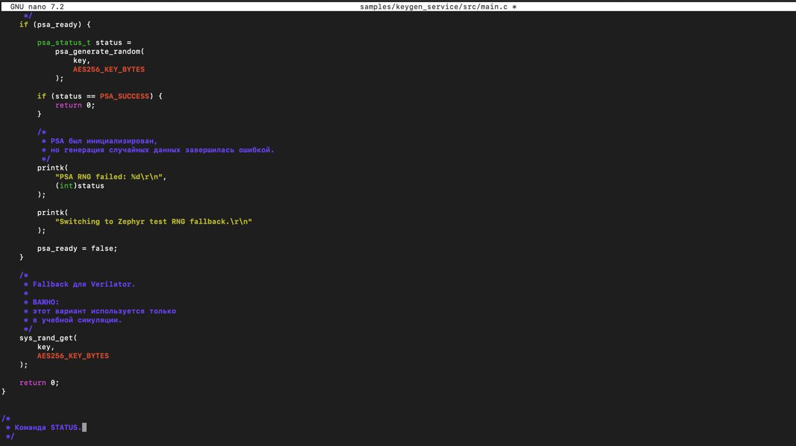

*Рисунок 9 — Основной путь PSA и явное переключение на тестовый RNG*

Функция `bytes_to_hex()` преобразует каждый байт в два символа из `0123456789ABCDEF`. Поэтому 32 байта дают 64 hex-символа. Строковый буфер имеет размер 65 байт с учётом завершающего нуля.

Команда GENKEY отправляет ответ в виде `KEY:<hex>\r\n`. После отправки код вызывает `memset()` для бинарного буфера. На скриншоте видно обычное обнуление, а не специализированный механизм гарантированного стирания секретов.

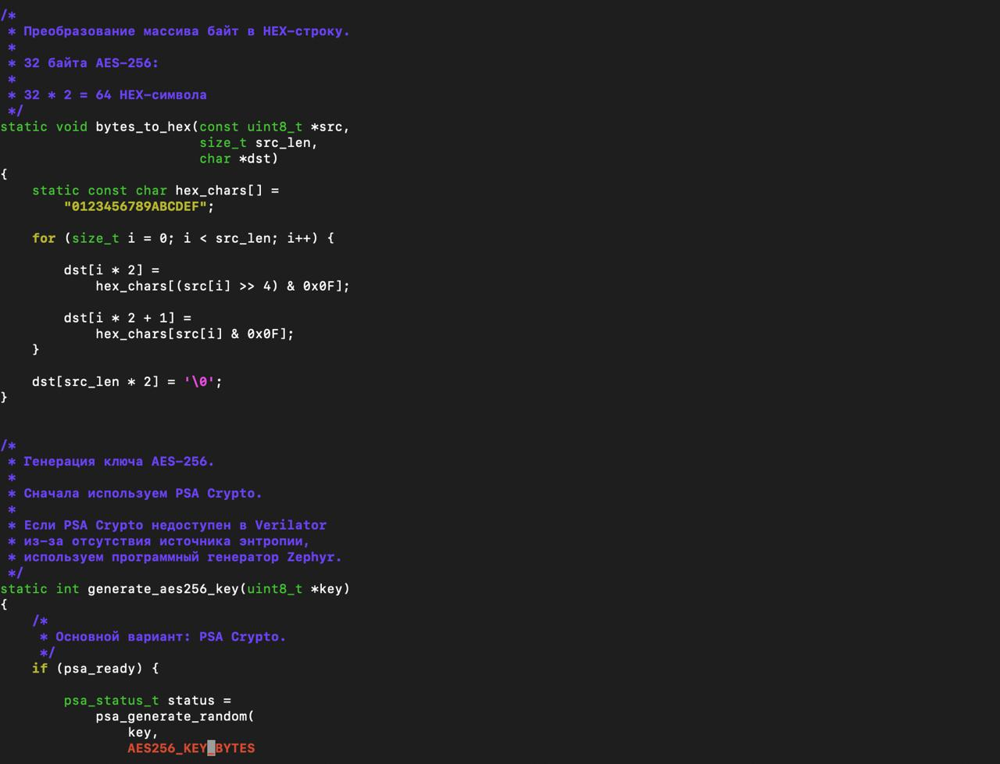

*Рисунок 10 — Преобразование массива байтов в HEX*

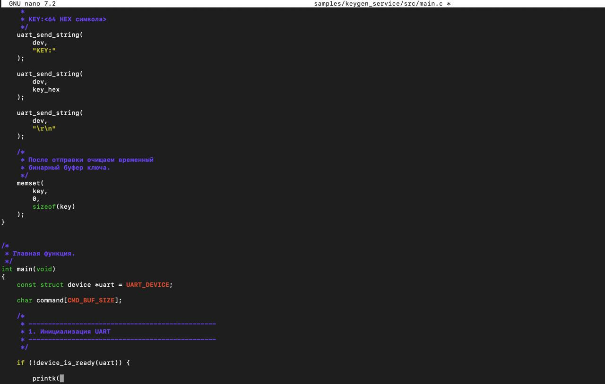

*Рисунок 11 — Формат ответа KEY и очистка бинарного буфера*

Здесь сервис выдаёт 32 байта ключевого материала. Шифрование AES и создание объекта ключа в хранилище PSA не выполняются. Соответствие длины AES-256 не доказывает непредсказуемость материала.

### 4.5. Протокол команд

| Команда или условие | Ответ | Назначение |
| --- | --- | --- |
| `STATUS` | `OK:READY` | Готовность обработчика команд |
| `GENKEY` | `KEY:<64 hex-символа>` | Выдача 32 байт в HEX |
| `EXIT` | `OK:BYE` | Выход из основного цикла |
| Неизвестная команда | `ERR:UNKNOWN_CMD` | Ошибка имени команды |
| Слишком длинная строка | `ERR:CMD_TOO_LONG` | Ошибка длины команды |
| Ошибка функции генерации | `ERR:KEYGEN_FAIL` | Предусмотренный ответ ошибки |

В реализованном STATUS нет поля режима RNG: `OK:READY` отправляется и при тестовом fallback. Поэтому клиент по одному STATUS не может определить, доступна ли криптографическая генерация. Режим виден в загрузочном журнале.

EXIT завершает цикл приложения. Сам процесс Verilator и ядро Zephyr автоматически от этой команды не завершаются.

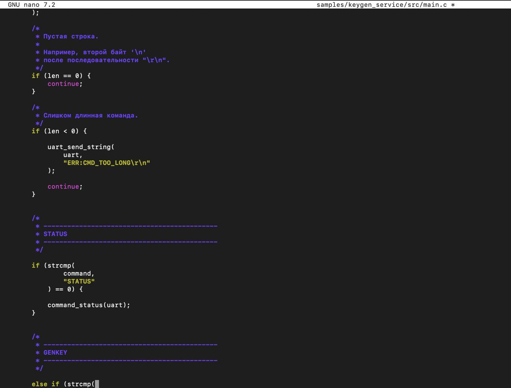

*Рисунок 12 — Обработка STATUS и слишком длинной команды*

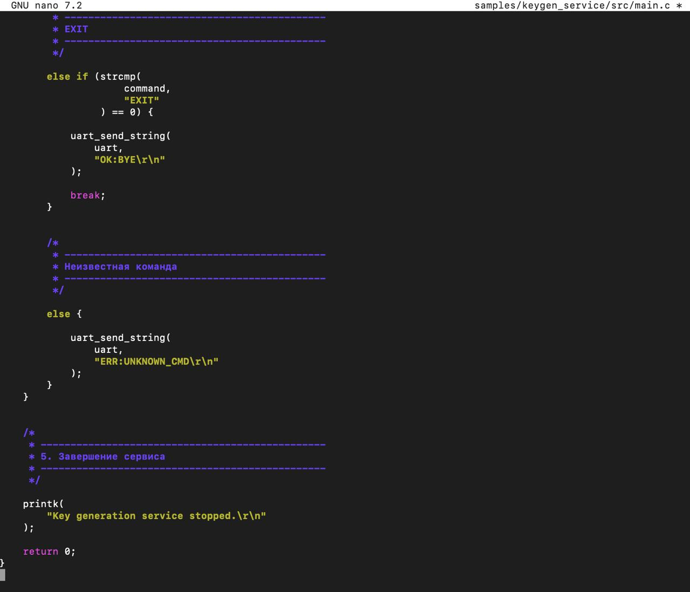

*Рисунок 13 — Обработка EXIT и неизвестной команды*

### 4.6. Сборка

```bash
west build -b opentitan_earlgrey samples/keygen_service --pristine \
    -DCMAKE_EXPORT_COMPILE_COMMANDS=ON
```

Итоговая сборка завершилась шагом `[214/214] Linking C executable zephyr/zephyr.elf`.

| Область | Использовано | Доступно | Доля |
| --- | ---: | ---: | ---: |
| ROM | 22 356 Б | 1 МБ | 2,13% |
| RAM | 6 020 Б | 64 КБ | 9,19% |

Показатели относятся к итоговому приложению с тестовым fallback. Это данные линкера, а не замеры динамической памяти. В более ранней версии на скриншотах видны другие размеры; для итогового отчёта использованы значения финальной сборки.

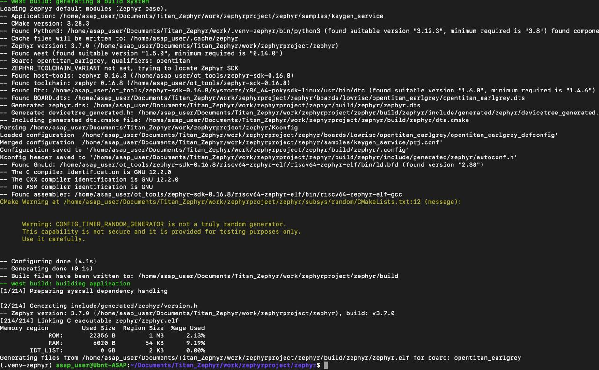

*Рисунок 14 — Итоговая сборка, предупреждение RNG и размеры ROM/RAM*

### 4.7. Запуск симулятора

Использованы предварительно подготовленные образы OpenTitan. Команды для повторения запуска в той же среде:

```bash
OT=~/Documents/Titan_Zephyr/work/opentitan
SIM=$(find "$OT/bazel-bin" "$HOME/.cache/bazel/_bazel_$(whoami)" \
    -name Vchip_sim_tb -type f 2>/dev/null | head -1)
ROM=$OT/bazel-bin/sw/device/lib/testing/test_rom/test_rom_sim_verilator.39.scr.vmem
OTP=$OT/bazel-bin/hw/ip/otp_ctrl/data/img_rma.24.vmem
ELF=$PWD/build/zephyr/zephyr.elf

test -f "$SIM" && echo "SIM OK"
test -f "$ROM" && echo "ROM OK"
test -f "$OTP" && echo "OTP OK"
test -f "$ELF" && echo "ELF OK"

"$SIM" --verbose-mem-load \
    --meminit=rom,"$ROM" \
    --meminit=otp,"$OTP" \
    --meminit=flash0,"$ELF"
```

Пути и имена VMEM-образов относятся к использованной сборке. UART PTY следует брать из текущего вывода симулятора. В первоначальных запусках использовался `/dev/pts/2`, в итоговой проверке — `/dev/pts/4`.

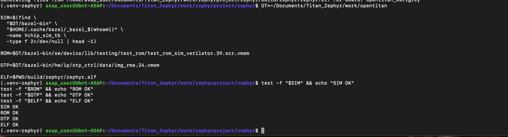

*Рисунок 15 — Проверка наличия симулятора и образов*

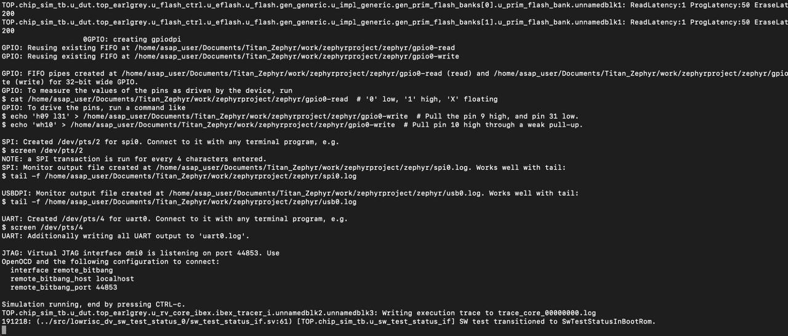

*Рисунок 16 — Создание порта UART /dev/pts/4*

При отладке обнаружились два процесса `Vchip_sim_tb` и занятый порт виртуального JTAG 44853. На скриншотах показаны завершение старых процессов и новый запуск. Номера PID являются параметрами конкретного сеанса, их нельзя копировать для другого запуска. Порт 44853 относится к JTAG, обмен клиента с UART происходит через PTY.

Для контроля загрузки:

```bash
cd ~/Documents/Titan_Zephyr/work/zephyrproject/zephyr
tail -f uart0.log
```

Итоговый журнал содержит:

```text
*** Booting Zephyr OS build v3.7.0 ***
=== AES-256 Key Generation Service ===
UART ready.
PSA Crypto initialization failed: -148
RNG mode: Zephyr test fallback (Verilator)
READY
```

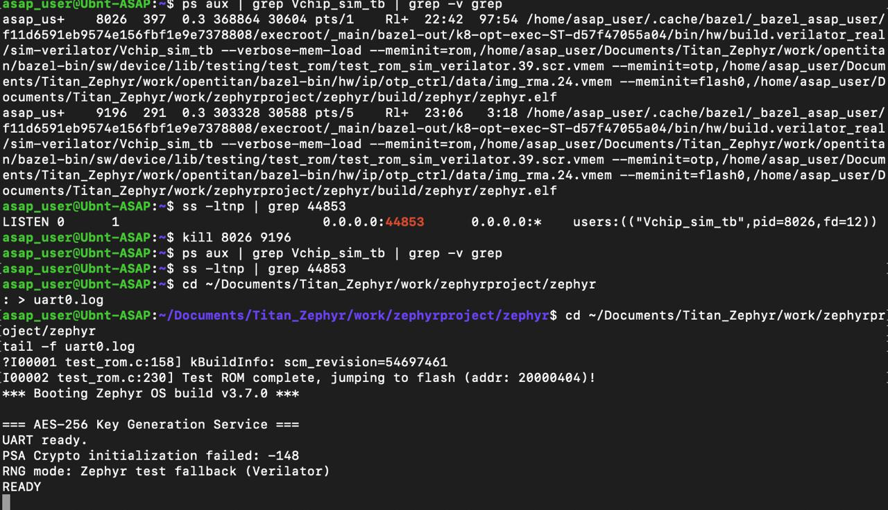

*Рисунок 17 — Перезапуск симуляции и готовность сервиса в тестовом режиме*

### 4.8. Хост-клиент

Клиент использует пакетный режим и принимает имя порта через аргумент. Порт открывается с параметрами 115200 8N1, тайм-аут чтения — 5 секунд. После короткой паузы клиент очищает старые загрузочные сообщения из входного буфера.

Функция `send_command()` отправляет команду с `\n`, вызывает `flush()`, читает одну строку, декодирует ASCII и удаляет пробельные символы по краям. Для GENKEY клиент проверяет маркер `KEY:`, длину 64 символа, допустимость hex-символов и преобразование `bytes.fromhex()`.

Вместо отдельного ожидания загрузочного маркера READY реализованный клиент начинает проверку с STATUS. Поэтому запускать его нужно после готовности сервиса, показанной в `uart0.log`.

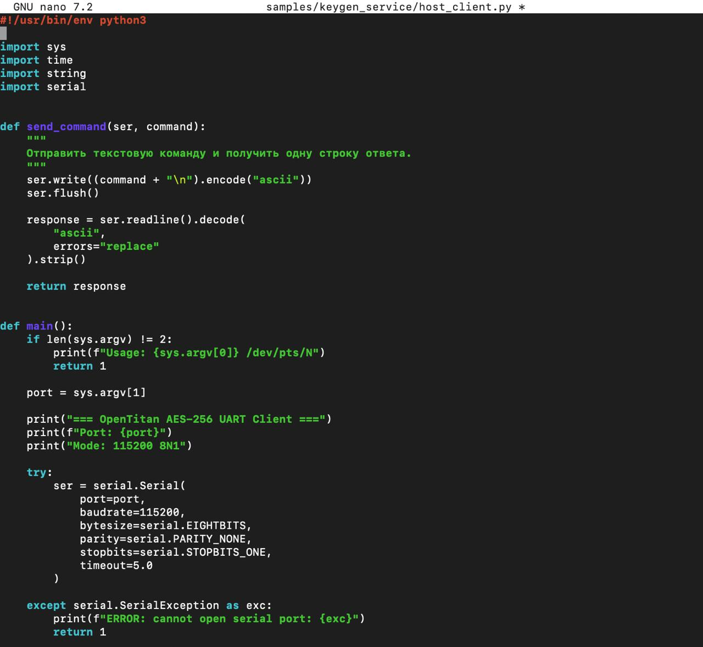

*Рисунок 18 — Открытие порта и функция отправки команды*

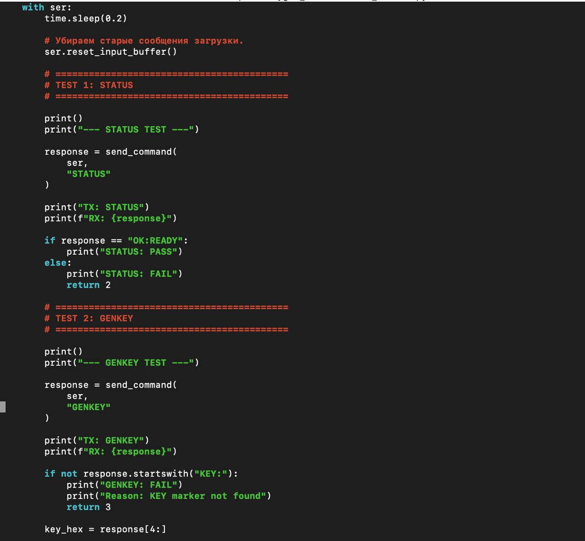

*Рисунок 19 — Проверки STATUS и маркера KEY*

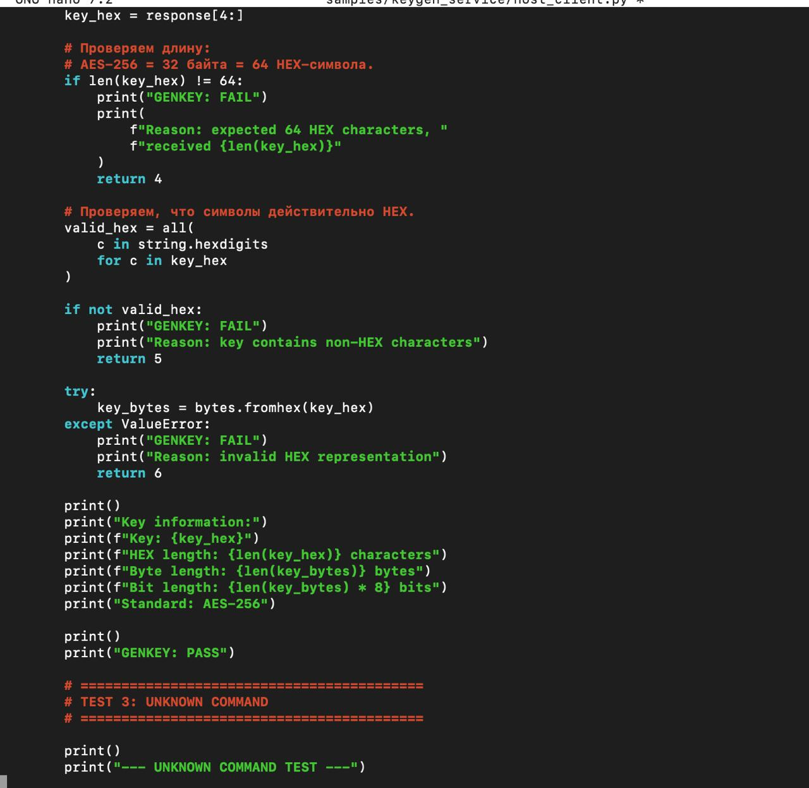

*Рисунок 20 — Проверка HEX и вывод длины ключевого материала*

### 4.9. Результаты проверки

После появления READY был выполнен запуск:

```bash
python3 samples/keygen_service/host_client.py /dev/pts/4
```

Клиент получил следующие ответы:

| Тест | Отправлено | Получено | Результат |
| --- | --- | --- | --- |
| Готовность | `STATUS` | `OK:READY` | `STATUS: PASS` |
| Выдача материала | `GENKEY` | `KEY:<64 hex-символа>` | `GENKEY: PASS` |
| Неизвестная команда | `HELLO` | `ERR:UNKNOWN_CMD` | `UNKNOWN COMMAND: PASS` |
| Завершение | `EXIT` | `OK:BYE` | `EXIT: PASS` |

Фактический пример из учебного теста:

```text
KEY:93C8DA13D65CB056253FF2490FB2CFEF815DDCEF6BF3F62F15A24B4876D62C8D
HEX length: 64 characters
Byte length: 32 bytes
Bit length: 256 bits
Standard: AES-256
ALL TESTS PASSED
```

Этот материал получен тестовым RNG. Строка `Standard: AES-256` в клиенте обозначает соответствие длины 256 бит, а не проверку безопасности или выполнение AES-шифрования.

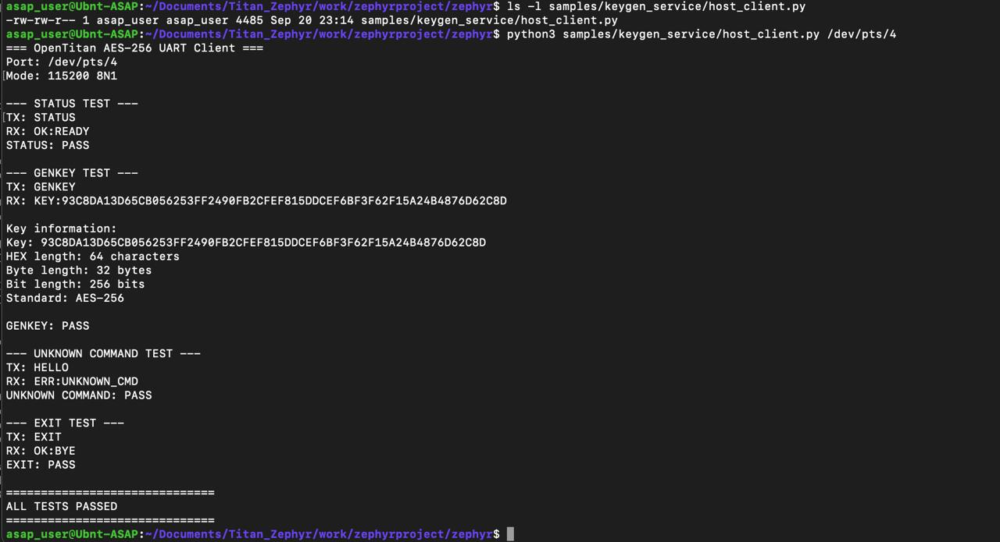

*Рисунок 21 — Успешные проверки STATUS, GENKEY, HELLO и EXIT*

<a id="section-5"></a>

## 5. Соответствие заданию и границы результата

| Требование | Фактическое выполнение |
| --- | --- |
| UART через Device Tree | Реализовано |
| Использование PSA API | В коде присутствуют init и generate_random |
| Успешная криптографическая генерация через PSA | В итоговом запуске не подтверждена, init вернул -148 |
| GENKEY, STATUS, EXIT | Проверены клиентом |
| Автоматический разбор KEY и подсчёт длины | Проверены, 64 HEX / 32 байта / 256 бит |
| Обработка неизвестной команды | Проверена командой HELLO |
| Продолжение работы при недоступном PSA RNG | Реализовано явно в приложении, через тестовый fallback |
| Стойкий программный источник при отказе аппаратного RNG | Не подтверждён, использован тестовый таймерный RNG |
| Ожидание READY клиентом | Отдельного ожидания нет, используется STATUS после запуска |
| Работа с аппаратным RNG реального OpenTitan | На реальном оборудовании не проверялась |

Обработка слишком длинной строки присутствует в коде, но отдельный тест этой ветви на скриншотах не показан. Повторная генерация нескольких значений, статистические проверки и измерения времени также не представлены. Даже различие нескольких значений не доказывало бы криптографическую стойкость.

<a id="section-6"></a>

## 6. Порядок повторного запуска

1. Активировать окружение и перейти в каталог Zephyr.
2. Собрать `samples/keygen_service` с итоговой конфигурацией.
3. Убедиться, что старые сеансы Verilator завершены, проверить пути к ROM, OTP и ELF.
4. Запустить симулятор и найти актуальный UART PTY.
5. Дождаться READY в журнале, проверить строку режима RNG.
6. Запустить `host_client.py` с актуальным PTY.
7. Проверить четыре результата PASS и итоговую строку ALL TESTS PASSED.
8. После EXIT перезапустить приложение для повторной проверки. Симулятор остановить через Ctrl+C в его терминале.

Для перехода к реальным ключам требуется обеспечить безопасную энтропию для PSA, исключить тестовую ветвь и подтверждать готовность криптоподсистемы отдельно от готовности UART. В данной работе такая конфигурация не реализована.

<a id="section-7"></a>

## 7. Вывод

Разработан UART-сервис командной выдачи 32-байтового материала и Python-клиент для его проверки. Приложение успешно собрано для OpenTitan Earlgrey и запущено в Verilator. Клиент подтвердил работу STATUS, GENKEY, обработки неизвестной команды и EXIT, а также формат 64 hex-символа / 32 байта / 256 бит.

При инициализации PSA Crypto получена ошибка недостатка энтропии -148. Сервис продолжил работу в явно реализованном тестовом режиме Zephyr. Таким образом, выполненный эксперимент подтверждает работоспособность протокола и обработку отказа PSA, но не подтверждает генерацию криптографически стойких AES-256 ключей.

<a id="section-8"></a>

## 8. Источники

1. [Zephyr 3.7.0 — PSA Crypto](https://docs.zephyrproject.org/3.7.0/services/crypto/psa_crypto.html).
2. [Zephyr — Migration guide to v3.7.0](https://docs.zephyrproject.org/latest/releases/migration-guide-3.7.html).
3. [Zephyr 3.7.0 — Random Number Generation](https://docs.zephyrproject.org/3.7.0/services/crypto/random/index.html).
4. [Zephyr 3.7.0 — Entropy](https://docs.zephyrproject.org/3.7.0/hardware/peripherals/entropy.html).
5. [Intel TinyCrypt — исходный репозиторий и статус поддержки](https://github.com/intel/tinycrypt).
6. [Arm PSA Crypto API 1.2 — Status codes](https://arm-software.github.io/psa-api/crypto/1.2/api/library/status.html).

---

[К списку практических работ](../../README.md)
