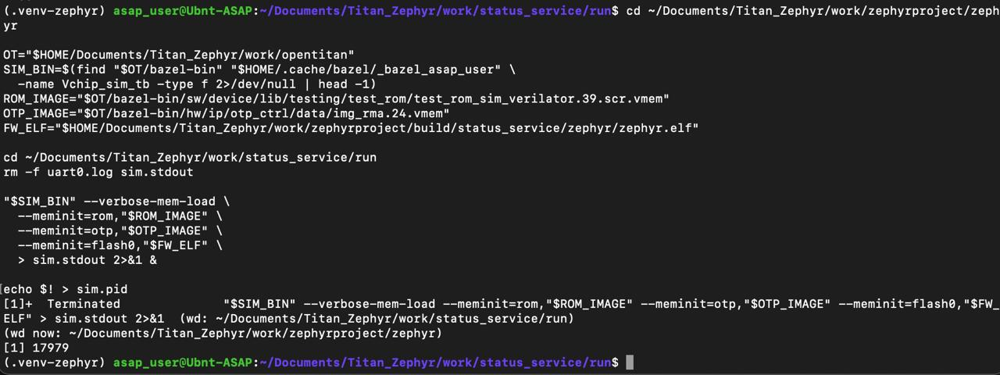
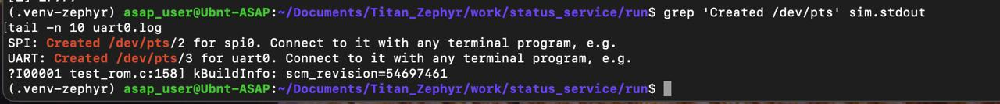
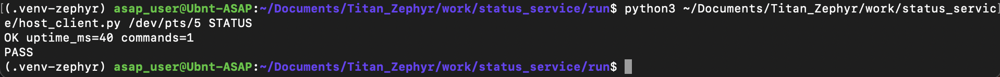
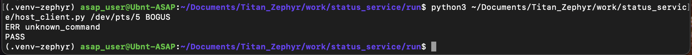
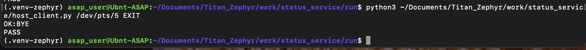

# Практическая работа №04 · UART-сервис состояния

[Все работы](../../README.md) · [Подготовка окружения](../01-environment/README.md)

**Платформа:** OpenTitan Earl Grey в симуляторе Verilator  
**ОС:** Zephyr RTOS 3.7.0  
**Язык сервиса:** C  
**Язык хост-клиента:** Python  

## Содержание

- [Цель работы](#section-1)
- [Задание](#section-2)
- [Среда выполнения](#section-3)
- [Ход работы](#section-4)
- [Результат](#section-5)
- [Исходный код сервиса](#appendix-a)
- [Хост-клиент](#appendix-b)

<a id="section-1"></a>

## 1. Цель работы

Сделать сервис, который принимает текстовые команды по UART и возвращает состояние приложения. Сервис работает под Zephyr на плате `opentitan_earlgrey`. Проверка идёт на модели OpenTitan в Verilator: Python-клиент на Linux открывает псевдотерминал, посылает команду и сверяет ответ.

Работа показывает, что приложение берёт UART из Device Tree, драйвер Zephyr передаёт байты, а хост может и запросить состояние, и завершить сервис.

<a id="section-2"></a>

## 2. Задание

После старта сервис отправляет `READY` и ждёт строку. Поддерживаются такие ответы:

| Команда | Ответ и действие |
| --- | --- |
| `STATUS` | Время работы в миллисекундах и число обработанных команд, например `OK uptime_ms=40 commands=1` |
| `EXIT` | Строка `OK:BYE`, затем выход из `main` |
| Любая другая непустая строка | `ERR unknown_command` |
| Строка длиннее буфера | `ERR line_too_long` |

Пока команд нет, сервис периодически пишет `ALIVE`. В финальной программе интервал heartbeat равен 100 мс. В первой версии стояла 1 с. Симуляция OpenTitan идёт медленно, и при периоде 1000 мс строка `ALIVE` в сеансе не успела появиться до остановки модели. Для отчёта оставлен интервал 100 мс. На реальной плате его можно вернуть к 1000 мс: текст протокола от этого не меняется.

Хост-клиент к API Zephyr не обращается. Он открывает PTY Linux в режиме 115200 8N1.

<a id="section-3"></a>

## 3. Среда выполнения

Работа выполнена на хосте `Ubnt-ASAP` (Ubuntu 24.04). Версии взяты из журнала сборки этого сеанса.

| Компонент | Значение |
| --- | --- |
| Zephyr RTOS | 3.7.0, сборка v3.7.0 |
| Плата | `opentitan_earlgrey` |
| Zephyr SDK | 0.16.8, `/home/asap_user/zephyr-sdk-0.16.8` |
| west | 1.5.0 |
| CMake | 3.28.3 |
| Компилятор | GCC 12.2.0, `riscv64-zephyr-elf-gcc` |
| Python | 3.12.3 |
| Модель | `Vchip_sim_tb`, области `rom`, `otp`, `flash0` |
| Параметры порта | 115200 бод, 8 бит, без чётности, 1 стоп-бит |

В журнале UART этого сеанса был `/dev/pts/3`. На снимках отдельной проверки клиент открывал `/dev/pts/5`. Номер PTY назначает Verilator при каждом запуске.

<a id="section-4"></a>

## 4. Ход работы

### 4.1. Состав проекта

Каталог приложения — `~/Documents/Titan_Zephyr/work/status_service`:

| Путь в проекте | Назначение |
| --- | --- |
| `CMakeLists.txt` | Подключение Zephyr и исходников приложения |
| `prj.conf` | Конфигурация приложения |
| `src/main.c` | UART-сервис состояния |
| `host_client.py` | Проверка команд с Linux-хоста |
| `run/uart0.log` | Вывод UART |
| `run/sim.stdout` | Вывод симулятора, включая путь к UART PTY |
| `run/sim.pid` | PID фонового процесса симулятора |

`CMakeLists.txt` подключает Zephyr и единственный исходный файл:

```cmake
cmake_minimum_required(VERSION 3.20.0)
find_package(Zephyr REQUIRED HINTS $ENV{ZEPHYR_BASE})
project(status_service)

target_sources(app PRIVATE src/main.c)
```

В `prj.conf` включены последовательный драйвер и стек главного потока:

```conf
CONFIG_SERIAL=y
CONFIG_MAIN_STACK_SIZE=2048
```

`CONFIG_SERIAL` нужен драйверу UART. Стек `main` задан в 2048 байт: ответ `STATUS` собирается локальным буфером `snprintk`.

### 4.2. Как устроен сервис

UART консоли берётся из дерева устройств платы:

```c
#define UART_DEV DEVICE_DT_GET(DT_CHOSEN(zephyr_console))
#define LINE_SIZE 32
#define HEARTBEAT_MS 100
```

`DT_CHOSEN(zephyr_console)` указывает узел, который плата уже выбрала консолью. `DEVICE_DT_GET` получает устройство Zephyr. Если `device_is_ready()` возвращает ложь, `main` завершается с кодом 1 и в цикл не входит.

Дальше сервис пишет `READY\r\n` и обрабатывает байты:

1. `uart_poll_in()` забирает байты, которые уже есть в приёмнике. Если данных нет, вызов сразу возвращает ненулевой код; если байт получен — возвращает 0.
2. Символ `\r` или `\n` закрывает строку. Пустая строка пропускается, поэтому второй байт пары CRLF не становится ещё одной командой.
3. Строка длиннее 31 символа помечается флагом. На конце строки сервис отвечает `ERR line_too_long` и счётчик команд не увеличивает.
4. Перед разбором непустой команды счётчик `commands` увеличивается на единицу. Поэтому в ответе на первый `STATUS` уже стоит `commands=1`.
5. `STATUS` форматируется через `snprintk`: `OK uptime_ms=%u commands=%u`. Время берётся из `k_uptime_get_32()`.
6. `EXIT` отправляет `OK:BYE` и возвращает 0 из `main`. Приложение на этом заканчивается. Процесс Verilator этой командой не останавливается: его завершают с хоста.
7. Любая другая непустая строка даёт `ERR unknown_command`.
8. Если с прошлого `ALIVE` прошло `HEARTBEAT_MS`, сервис пишет `ALIVE`. В итоговом коде это 100 мс. Момент отсчитывается через `k_uptime_get()`.
9. `k_sleep(K_MSEC(1))` делает короткую паузу между опросами UART.

Передача идёт по байтам функцией `uart_poll_out()`. Полный текст `src/main.c` приведён в приложении А.

### 4.3. Хост-клиент

`host_client.py` принимает путь к PTY и одну команду. Команда переводится в верхний регистр, пустая строка отвергается.

Порт открывается как `O_RDWR | O_NOCTTY | O_NONBLOCK`. Флаги termios сбрасываются в сырой режим, скорость — `B115200`, формат кадра — `CS8 | CREAD | CLOCAL`. Перед отправкой входная очередь сбрасывается `TCIFLUSH`, чтобы старый `ALIVE` не попал в разбор новой команды.

Клиент пишет `команда\r\n` и читает строки до таймаута 120 с. Строки `READY` и `ALIVE` пропускаются: heartbeat может прийти раньше ответа. Остальное сравнивается так:

| Команда | Какая строка считается верной |
| --- | --- |
| `STATUS` | `OK uptime_ms=<число> commands=<число>` |
| `EXIT` | ровно `OK:BYE` |
| любая другая | ровно `ERR unknown_command` |

Совпадение печатает ответ и `PASS`, код возврата 0. Чужая строка — `FAIL`. Тишина до конца таймаута — `TIMEOUT`. Текст клиента — в приложении Б.

### 4.4. Сборка

Окружение и сборка:

```bash
cd ~/Documents/Titan_Zephyr/work
source .venv-zephyr/bin/activate
cd zephyrproject
west build -b opentitan_earlgrey ../status_service \
  -d build/status_service --pristine
```

West дошёл до линковки, шаг `[103/103] Linking C executable zephyr/zephyr.elf`. Итог линкера:

```text
Memory region         Used Size  Region Size  %age Used
             ROM:       15600 B         1 MB      1.49%
             RAM:        5232 B        64 KB      7.98%
        IDT_LIST:          0 GB         2 KB      0.00%
Generating files from .../build/status_service/zephyr/zephyr.elf
    for board: opentitan_earlgrey
```

После замены интервала `ALIVE` с 1000 мс на 100 мс проект собран той же командой ещё раз. ROM и RAM не изменились: правка константы не добавила кода. Образ лежит в `zephyrproject/build/status_service/zephyr/zephyr.elf`.

### 4.5. Запуск в Verilator

Симулятор загружает Test ROM, OTP-образ `img_rma.24.vmem` и ELF Zephyr в `flash0`:

```bash
OT="$HOME/Documents/Titan_Zephyr/work/opentitan"
SIM_BIN=$(find "$OT/bazel-bin" "$HOME/.cache/bazel/_bazel_asap_user" \
  -name Vchip_sim_tb -type f 2>/dev/null | head -1)
ROM_IMAGE="$OT/bazel-bin/sw/device/lib/testing/test_rom/test_rom_sim_verilator.39.scr.vmem"
OTP_IMAGE="$OT/bazel-bin/hw/ip/otp_ctrl/data/img_rma.24.vmem"
FW_ELF="$HOME/Documents/Titan_Zephyr/work/zephyrproject/build/status_service/zephyr/zephyr.elf"

cd ~/Documents/Titan_Zephyr/work/status_service/run
rm -f uart0.log sim.stdout sim.pid

"$SIM_BIN" --verbose-mem-load \
  --meminit=rom,"$ROM_IMAGE" \
  --meminit=otp,"$OTP_IMAGE" \
  --meminit=flash0,"$FW_ELF" \
  > sim.stdout 2>&1 &
echo $! > sim.pid
```

`SIM_BIN` — файл `Vchip_sim_tb` из дерева OpenTitan. Пути относятся к рабочему окружению этого запуска; каталог `_bazel_asap_user` нужно заменить на каталог кэша своего пользователя. Порт для клиента берётся из строки `UART: Created … for uart0` в `sim.stdout`, а не из первого попавшегося `/dev/pts/*`.

В журнале сеанса сервис поднялся так:

```text
Сервис запущен
UART: Created /dev/pts/3 for uart0.
?I00001 test_rom.c:158] kBuildInfo: scm_revision=54697461
I00002 test_rom.c:230] Test ROM complete, jumping to flash (addr: 20000404)!
*** Booting Zephyr OS build v3.7.0 ***
READY
```

После пересборки с heartbeat 100 мс в том же виде журнала появилась строка `ALIVE`. В `uart0.log` она стоит пятой.





### 4.6. Проверка команд

Для проверки клиентом выполняются команды с актуальным UART PTY. В показанном сеансе использован `/dev/pts/5`:

```bash
cd ~/Documents/Titan_Zephyr/work/status_service
python3 host_client.py /dev/pts/5 STATUS
python3 host_client.py /dev/pts/5 BOGUS
python3 host_client.py /dev/pts/5 EXIT
```

После `EXIT` перед повторной проверкой приложение нужно запустить заново.

Первые опросы `STATUS` с ожиданием 5 с напечатали обрезанную строку `OK uptime_ms=`. Модель не успела отдать строку целиком, и разбор остановился на середине. С ожиданием 60 с пришёл полный ответ:

```text
OK uptime_ms=178 commands=3
```

Число 3 здесь ожидаемо: это уже третий `STATUS` в том же запуске, и сервис посчитал предыдущие попытки тоже.

Следом отдельно проверены `BOGUS` и `EXIT`:

```text
ERR unknown_command
OK:BYE
```

После пересборки клиент `host_client.py` на порту `/dev/pts/3` дал три подряд успешных проверки:

```text
OK uptime_ms=176 commands=1
PASS
ERR unknown_command
PASS
OK:BYE
PASS
```

`commands=1` значит, что `STATUS` был первой засчитанной командой нового запуска. Значение `uptime_ms` зависит от момента запроса: на снимках другого сеанса оно равно 40.

Снимки сделаны на порту `/dev/pts/5`.







Сводка проверок клиента:

| Проверка | Порт | Ответ сервиса | Итог |
| --- | --- | --- | --- |
| `STATUS`, снимок | `/dev/pts/5` | `OK uptime_ms=40 commands=1` | PASS |
| `BOGUS`, снимок | `/dev/pts/5` | `ERR unknown_command` | PASS |
| `EXIT`, снимок | `/dev/pts/5` | `OK:BYE` | PASS |
| `STATUS`, журнал | `/dev/pts/3` | `OK uptime_ms=176 commands=1` | PASS |
| `BOGUS`, журнал | `/dev/pts/3` | `ERR unknown_command` | PASS |
| `EXIT`, журнал | `/dev/pts/3` | `OK:BYE` | PASS |

Ответ `ERR line_too_long` в программе есть. Отдельной командой длиннее буфера в этом сеансе его не проверяли.

После проверки симулятор останавливается так:

```bash
kill "$(cat ~/Documents/Titan_Zephyr/work/status_service/run/sim.pid)"
```

### 4.7. Что пришлось поправить при запуске

Интервал `ALIVE` в первой сборке был 1000 мс. Поиск строки `ALIVE` в `uart0.log` ничего не дал: модель к этому моменту уже остановили, и heartbeat с периодом 1 с в лог не попал. В `src/main.c` константу заменили на 100 мс и пересобрали проект. Новый запуск дождался heartbeat, в журнале есть и `READY`, и `ALIVE`.

Короткий таймаут чтения тоже мешал. При ожидании 5 с клиент видел начало `OK uptime_ms=` без хвоста строки. Ожидание 60 с у пробного скрипта и 120 с у `host_client.py` уже хватает, чтобы дочитать ответ в этой симуляции.

Порт нужно брать из строки `UART: Created … for uart0`. Verilator поднимает отдельный PTY на SPI и отдельный на UART. На снимке это `/dev/pts/2` для `spi0` и `/dev/pts/3` для `uart0`. В другом запуске проверка шла уже через `/dev/pts/5`. Если открыть порт SPI, сервис на том конце не отвечает, и клиент заканчивает по `TIMEOUT`. Такой промах в работе тоже был: порт `/dev/pts/4` оказался не UART сервиса.

<a id="section-5"></a>

## 5. Результат

Сервис собран для `opentitan_earlgrey`. Образ занимает 15 600 байт ПЗУ (1,49% области 1 МБ) и 5 232 байта ОЗУ (7,98% области 64 КБ). В Verilator загрузился Zephyr 3.7.0, в UART появились `READY` и `ALIVE`.

Клиент подтвердил три сценария: запрос `STATUS`, неизвестную команду и завершение через `EXIT`. Все три закончились `PASS` и в журнале на `/dev/pts/3`, и на снимках порта `/dev/pts/5`.

Из Zephyr использованы дерево устройств, проверка готовности устройства, `uart_poll_in`, `uart_poll_out`, `k_uptime_get`, `k_uptime_get_32`, `k_sleep`, а также `CONFIG_SERIAL` и `CONFIG_MAIN_STACK_SIZE`. Обмен проверен через псевдотерминал симулятора. Физическая плата в этой работе не использовалась.

<a id="appendix-a"></a>

## Приложение А. Исходный код сервиса

Файл `status_service/src/main.c`:

```c
#include <stdbool.h>
#include <stddef.h>
#include <string.h>

#include <zephyr/device.h>
#include <zephyr/drivers/uart.h>
#include <zephyr/kernel.h>
#include <zephyr/sys/printk.h>

#define UART_DEV DEVICE_DT_GET(DT_CHOSEN(zephyr_console))
#define LINE_SIZE 32
#define HEARTBEAT_MS 100

static void uart_write_string(const struct device *dev, const char *text)
{
    while (*text != '\0') {
        uart_poll_out(dev, (unsigned char)*text);
        text++;
    }
}

int main(void)
{
    const struct device *dev = UART_DEV;

    if (!device_is_ready(dev)) {
        return 1;
    }

    char line[LINE_SIZE];
    size_t length = 0;
    bool line_too_long = false;
    unsigned int commands = 0;
    int64_t next_heartbeat = k_uptime_get() + HEARTBEAT_MS;

    uart_write_string(dev, "READY\r\n");

    while (true) {
        unsigned char byte;

        while (uart_poll_in(dev, &byte) == 0) {
            if (byte == '\r' || byte == '\n') {
                if (line_too_long) {
                    uart_write_string(dev, "ERR line_too_long\r\n");
                    length = 0;
                    line_too_long = false;
                    continue;
                }

                if (length == 0) {
                    continue;
                }

                line[length] = '\0';
                commands++;

                if (strcmp(line, "STATUS") == 0) {
                    char response[64];

                    snprintk(response, sizeof(response),
                             "OK uptime_ms=%u commands=%u\r\n",
                             (unsigned int)k_uptime_get_32(), commands);
                    uart_write_string(dev, response);
                } else if (strcmp(line, "EXIT") == 0) {
                    uart_write_string(dev, "OK:BYE\r\n");
                    return 0;
                } else {
                    uart_write_string(dev, "ERR unknown_command\r\n");
                }

                length = 0;
            } else if (length < sizeof(line) - 1) {
                if (!line_too_long) {
                    line[length++] = (char)byte;
                }
            } else {
                line_too_long = true;
            }
        }

        int64_t now = k_uptime_get();
        if (now >= next_heartbeat) {
            uart_write_string(dev, "ALIVE\r\n");
            next_heartbeat = now + HEARTBEAT_MS;
        }

        k_sleep(K_MSEC(1));
    }

    return 0;
}
```

<a id="appendix-b"></a>

## Приложение Б. Хост-клиент

Файл `status_service/host_client.py`:

```python
#!/usr/bin/env python3
"""Small UART/PTY client for the Zephyr status service."""

import argparse
import os
import re
import select
import sys
import termios
import time


def response_is_expected(command: str, response: str) -> bool:
    if command == "STATUS":
        return re.fullmatch(
            r"OK uptime_ms=\d+ commands=\d+", response
        ) is not None
    if command == "EXIT":
        return response == "OK:BYE"
    return response == "ERR unknown_command"


def main() -> int:
    parser = argparse.ArgumentParser(
        description="Send a command to the Zephyr UART status service"
    )
    parser.add_argument("port", help="UART PTY, for example /dev/pts/5")
    parser.add_argument("command", help="STATUS, EXIT, or another command")
    parser.add_argument("--timeout", type=float, default=120.0)
    args = parser.parse_args()

    command = args.command.strip().upper()
    if not command:
        print("ERROR: command is empty", file=sys.stderr)
        return 2

    fd = os.open(args.port, os.O_RDWR | os.O_NOCTTY | os.O_NONBLOCK)
    old_settings = termios.tcgetattr(fd)

    try:
        settings = termios.tcgetattr(fd)
        settings[0] = 0  # input flags: raw mode
        settings[1] = 0  # output flags: raw mode
        settings[2] = termios.CS8 | termios.CREAD | termios.CLOCAL
        settings[3] = 0  # local flags: raw mode
        settings[4] = termios.B115200
        settings[5] = termios.B115200
        settings[6][termios.VMIN] = 0
        settings[6][termios.VTIME] = 0
        termios.tcsetattr(fd, termios.TCSANOW, settings)
        termios.tcflush(fd, termios.TCIFLUSH)

        os.write(fd, (command + "\r\n").encode("ascii"))
        pending = bytearray()
        deadline = time.monotonic() + args.timeout

        while time.monotonic() < deadline:
            remaining = deadline - time.monotonic()
            readable, _, _ = select.select([fd], [], [], min(0.2, remaining))
            if not readable:
                continue

            try:
                chunk = os.read(fd, 256)
            except BlockingIOError:
                continue

            if not chunk:
                continue

            pending.extend(chunk)
            while b"\n" in pending:
                raw_line, _, rest = pending.partition(b"\n")
                pending = bytearray(rest)
                response = raw_line.decode("utf-8", errors="replace").strip()

                # The service may print its periodic heartbeat before replying.
                if not response or response in {"READY", "ALIVE"}:
                    continue

                print(response)
                if response_is_expected(command, response):
                    print("PASS")
                    return 0

                print("FAIL: unexpected response", file=sys.stderr)
                return 1

        print("TIMEOUT: response not received", file=sys.stderr)
        return 1
    finally:
        termios.tcsetattr(fd, termios.TCSANOW, old_settings)
        os.close(fd)


if __name__ == "__main__":
    raise SystemExit(main())
```

---

[К списку практических работ](../../README.md)
