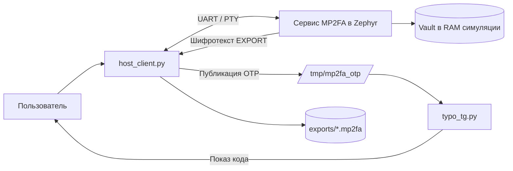
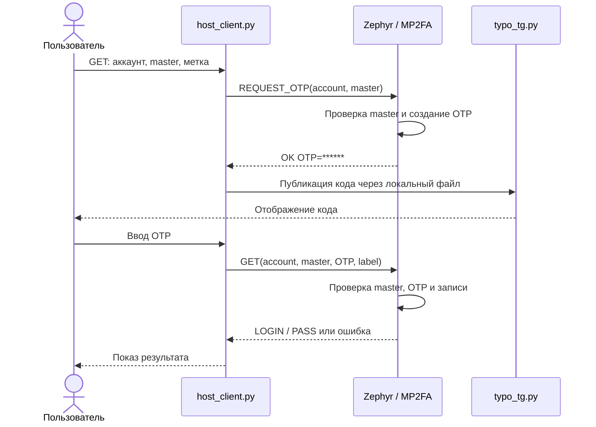

# Лабораторная работа №5 — MP2FA: менеджер паролей с двухфакторной аутентификацией

> **Направление:** OpenTitan + Zephyr · **Платформа:** Earl Grey (Verilator) · **ОС:** Zephyr 3.7  
> **Формат:** разработка программного комплекса, исследование границ доверия и демонстрация работы прототипа.

[← Все лабораторные Zephyr](../../README.md) · [Лабораторная №6: синхронизация →](../06-synchronization/README.md)

## 1. Аннотация

**MP2FA (Manager Password 2FA)** — учебный прототип менеджера паролей с двухфакторной проверкой доступа, работающий в связке с моделируемой системой OpenTitan Earl Grey и Zephyr. Вместо хранения секретов исключительно в Linux-приложении используется сервис, запущенный в моделируемой целевой среде. Хост отвечает за взаимодействие с пользователем и передачу команд по UART, а сервис Zephyr управляет учётными записями, проверяет мастер-пароль и одноразовый код и формирует зашифрованный экспорт.

**Важно:** речь идёт об исследовательской модели доверенного контура, а не о готовом защищённом устройстве. Использование Verilator и программных криптографических алгоритмов само по себе не означает аппаратную защиту секретов OpenTitan.

## 2. Цель работы

Разработать и продемонстрировать программный комплекс управления паролями с двухфакторной аутентификацией на учебном стенде OpenTitan + Zephyr; определить границы ответственности приложения на хосте и сервиса в целевой системе.

### Задачи

1. Рассмотреть модель угроз для хранения паролей на пользовательском компьютере.
2. Спроектировать протокол обмена между хостом и сервисом Zephyr по UART.
3. Реализовать регистрацию аккаунта, сохранение секретов и просмотр списка записей.
4. Организовать запрос и одноразовую проверку OTP при получении секрета.
5. Продемонстрировать экспорт зашифрованного контейнера и получение статуса сервиса.
6. Оценить ограничения модели и определить направления развития.

## 3. Состав стенда

| Компонент | Назначение |
|---|---|
| **OpenTitan Earl Grey в Verilator** | Моделируемая система на кристалле, в которой выполняется целевое ПО |
| **Zephyr 3.7** | ОС для сервиса управления аккаунтами и секретами |
| **`firmware/src/main.c`** | Обработка команд и логика vault в целевом ПО (путь указан по материалам презентации) |
| **`host_client.py`** | Меню на стороне Linux, ввод команд и обмен по UART |
| **`typo_tg.py`** | Демонстрационная имитация второго канала доставки OTP |
| **`/tmp/mp2fa_otp/`** | Локальная директория для передачи тестового OTP между хост-компонентами |
| **`exports/*.mp2fa`** | Экспортируемые зашифрованные данные |

### Архитектура

Здесь **хост не является защищённой границей**: UART используется как открытый учебный канал, а имитация доставки OTP не обеспечивает независимый второй фактор в промышленном смысле.

## 4. Реализованные возможности

| Операция | Что делает | Где выполняется ключевая проверка |
|---|---|---|
| `REGISTER` | Создаёт учётную запись, выдаёт recovery-коды | Целевой сервис |
| `ADD` | Добавляет запись с меткой, логином и паролем | Целевой сервис |
| `LIST` | Возвращает перечень меток | Целевой сервис |
| `REQUEST_OTP` | Проверяет мастер-пароль и генерирует одноразовый код | Целевой сервис |
| `GET` | После проверки мастер-пароля и OTP выдаёт запись | Целевой сервис |
| `EXPORT` | Формирует зашифрованный контейнер | Целевой сервис |
| `STATUS` | Возвращает состояние приложения | Целевой сервис |

Подробный набор аргументов и формат ответов следует сверять с исходным кодом прошивки; таблица отражает сценарий демонстрации из презентации.

## 5. Сценарий получения секрета с OTP

По материалам проекта OTP используется однократно: после успешной выдачи секрета его действительность сбрасывается. В демонстрации также рассматривается ограничение неуспешных попыток (блокировка после трёх ошибок до перезапуска модели).

## 6. Ход выполнения

### Этап 1 — постановка задачи и модель угроз

Выделены риски локального и облачного хранения паролей; определены операции, которые должны выполняться в целевой среде, а не только на хосте. Выбран учебный сценарий vault с мастер-паролем и OTP.

### Этап 2 — архитектура и UART-протокол

Разделены роли симуляции, прошивки, терминального клиента и демонстрационного канала OTP. Команды и ответы передаются через UART0/PTY. При разработке учитывались ошибки авторизации, состояние аккаунта и одноразовость кода.

### Этап 3 — реализация приложения

В материалах представлены обработчики создания аккаунта, добавления и получения записи, проверка мастер-пароля, генерация OTP, экспорт. Указаны программные SHA-256 и AES-256-GCM; применение аппаратных криптоблоков OpenTitan остаётся направлением развития.

### Этап 4 — демонстрационный прогон

1. Запустить симуляцию и убедиться в появлении `READY`.
2. В отдельном терминале открыть демонстрационный канал `typo_tg.py`.
3. Запустить `host_client.py`.
4. Выполнить `REGISTER → ADD → LIST`.
5. Запросить `GET`, получить OTP через демонстрационный канал и подтвердить доступ.
6. Выполнить `EXPORT`, проверить создание файла `.mp2fa` с шифротекстом.
7. Запросить `STATUS` и завершить работу.

**Команды запуска:** в презентации названы `run_sim.sh`, `run_host.sh`, `run_typo_tg.sh`, `cleanup_demo.sh`, но полный код запуска не включён в этот архив документации. Используйте скрипты из исходного проекта после проверки их содержимого. Не следует выполнять их из произвольных путей, которых нет в репозитории.

## 7. Результаты

На демонстрационных материалах показаны регистрация, добавление и список записей, запрос OTP, получение секрета после второго подтверждения, запрос статуса и экспорт в файл. Пример ответа из демонстрации содержит `OK LOGIN=... PASS=...`; он иллюстрирует **учебное поведение**, но также показывает, что открытый UART нельзя считать защищённым транспортом.

**Критерии успешного выполнения:** сервис запускается; команды обрабатываются последовательно; без валидного OTP доступ к `GET` отклоняется; использованный OTP не принимается повторно; файл экспорта содержит зашифрованный контейнер, а не список открытых паролей.

## 8. Ограничения и направления развития

| Ограничение текущего стенда | Возможная доработка |
|---|---|
| Vault размещён в RAM симуляции и теряется после рестарта | Постоянное защищённое хранилище |
| Для AES/SHA используется программная реализация | Интеграция с аппаратными блоками OpenTitan |
| Используется тестовый источник случайности | Аппаратный источник энтропии и анализ его свойств |
| UART между хостом и моделью не защищён | Аутентификация и защита транспорта |
| `typo_tg.py` лишь имитирует отдельный канал | Независимая защищённая доставка OTP / TOTP |
| Импорт экспортированного контейнера не демонстрировался | Реализация и тестирование `IMPORT` |

**Безопасность:** не используйте в учебной программе настоящие пароли, токены и recovery-фразы. Файл экспорта с тестовыми данными также не следует считать защищённым без отдельной проверки реализации.

## 9. Вывод

Создан и продемонстрирован учебный программный комплекс, позволяющий исследовать хранение учётных данных и проверку двух факторов в связке OpenTitan + Zephyr. Работа показывает архитектурное разделение хоста и целевого сервиса и одновременно выявляет существенные ограничения симуляционного прототипа.

## 10. Материалы

- [Презентация MP2FA (PPTX)](materials/mp2fa-presentation.pptx)
- [Лабораторная №6 — синхронизация OpenTitan и Zephyr](../06-synchronization/README.md)

> **Примечание об исходном коде.** В присланном архиве `MP2FA.zip` обнаружена ошибка структуры ZIP (отсутствует корректная завершающая директория), поэтому исходники приложения сюда автоматически **не включены**. Для полноценной воспроизводимой лабораторной нужен исправный архив проекта.
