# Лабораторная работа №5 — MP2FA: менеджер паролей с двухфакторной аутентификацией

> **Направление:** OpenTitan + Zephyr · **Платформа:** Earl Grey (Verilator) · **ОС:** Zephyr 3.7  

[← Все лабораторные Zephyr](../../README.md) · [Лабораторная №6: синхронизация →](../06-synchronization/README.md)

## 1. Аннотация

**MP2FA (Manager Password 2FA)** — учебный прототип менеджера паролей с двухфакторной проверкой доступа, работающий в связке с моделируемой системой OpenTitan Earl Grey и Zephyr. Вместо хранения секретов исключительно в Linux-приложении используется сервис, запущенный в моделируемой целевой среде. Хост отвечает за взаимодействие с пользователем и передачу команд по UART, а сервис Zephyr управляет учётными записями, проверяет мастер-пароль и одноразовый код и формирует зашифрованный экспорт.

Прототип выполняется на модели Verilator. Хранилище расположено в оперативной памяти симуляции; аппаратная защита секретов в данной конфигурации не реализована.

## 2. Цель работы

Разработать и продемонстрировать программный комплекс управления паролями с двухфакторной аутентификацией на учебном стенде OpenTitan + Zephyr; определить границы ответственности приложения на хосте и сервиса в целевой системе.

### Задачи

1. Рассмотреть модель угроз для хранения паролей на пользовательском компьютере.
2. Спроектировать протокол обмена между хостом и сервисом Zephyr по UART.
3. Реализовать регистрацию аккаунта, сохранение секретов и просмотр списка записей.
4. Организовать запрос и одноразовую проверку OTP при получении секрета.
5. Продемонстрировать экспорт зашифрованного контейнера и получение статуса сервиса.
6. Оценить ограничения модели и определить направления развития.

## 3. Состав стенда

| Компонент | Назначение |
|---|---|
| **OpenTitan Earl Grey в Verilator** | Моделируемая система на кристалле, в которой выполняется целевое ПО |
| **Zephyr 3.7** | ОС для сервиса управления аккаунтами и секретами |
| **`firmware/src/main.c`** | Обработка команд и логика vault в целевом ПО  |
| **`host_client.py`** | Меню на стороне Linux, ввод команд и обмен по UART |
| **`typo_tg.py`** | Демонстрационная имитация второго канала доставки OTP |
| **`/tmp/mp2fa_otp/`** | Локальная директория для передачи тестового OTP между хост-компонентами |
| **`exports/*.mp2fa`** | Экспортируемые зашифрованные данные |

### Архитектура

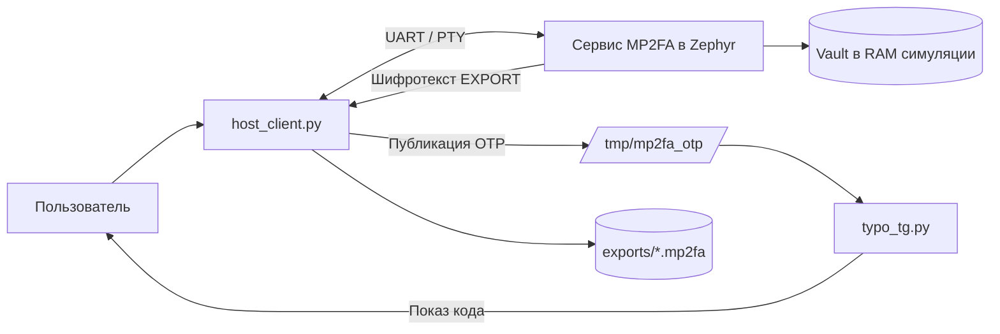

Здесь **хост не является защищённой границей**: UART используется как открытый учебный канал, а имитация доставки OTP не обеспечивает независимый второй фактор в промышленном смысле.

## 4. Реализованные возможности

| Операция | Что делает | Где выполняется ключевая проверка |
|---|---|---|
| `REGISTER` | Создаёт учётную запись, выдаёт recovery-коды | Целевой сервис |
| `ADD` | Добавляет запись с меткой, логином и паролем | Целевой сервис |
| `LIST` | Возвращает перечень меток | Целевой сервис |
| `REQUEST_OTP` | Проверяет мастер-пароль и генерирует одноразовый код | Целевой сервис |
| `GET` | После проверки мастер-пароля и OTP выдаёт запись | Целевой сервис |
| `EXPORT` | Формирует зашифрованный контейнер | Целевой сервис |
| `STATUS` | Возвращает состояние приложения | Целевой сервис |

Ниже перечислены команды UART-протокола v1, использованные в практической работе.

## 5. Сценарий получения секрета с OTP

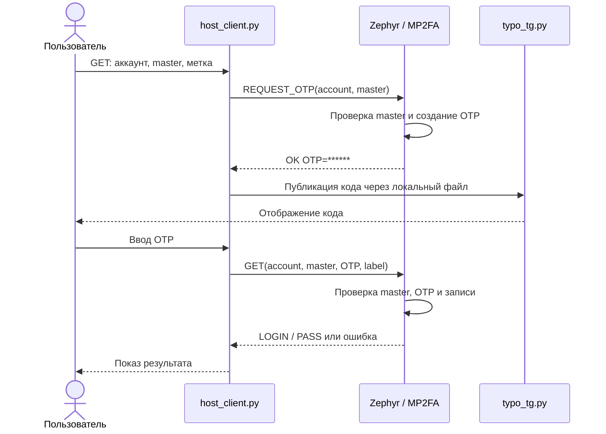

После успешной выдачи секрета OTP аннулируется. В прототипе предусмотрена блокировка после трёх неуспешных попыток до перезапуска модели.

## 6. Ход выполнения (практическая часть)

Практическая часть включает разработку трёх компонентов, настройку UART-протокола и проверку сценариев регистрации, хранения записей, получения OTP и экспорта.

### 6.1. Разделение приложения на три компонента

На первом этапе приложение разделено на целевой сервис и два хостовых процесса:

1. **Прошивка MP2FA (`firmware/src/main.c`)** выполняется в среде Zephyr 3.7 на моделируемом OpenTitan Earl Grey. Здесь находятся структуры аккаунтов и секретов, обработка команд, проверка мастер-пароля и OTP, формирование экспортного контейнера.
2. **Клиент `host_client.py`** работает в терминале Linux: принимает пользовательский ввод, формирует команды UART v1, показывает ответы и сохраняет полученный зашифрованный экспорт без его расшифровки.
3. **Демонстрационный канал `typo_tg.py`** работает во втором терминале. Хост публикует тестовый OTP в файле `/tmp/mp2fa_otp/<account>.otp`, а этот процесс отображает его пользователю. Это имитация второго канала, **не интеграция с Telegram**.

Взаимодействие организовано через UART0 модели и PTY (псевдотерминал) на хосте. Внутренняя база `vault` остаётся в RAM симуляции и очищается при перезапуске.

### 6.2. Разработка текстового протокола UART v1

Для обмена между компонентами используется текстовый UART-протокол v1. Поля команд передаются без пробелов.

| Команда или шаблон | Действие | Наблюдаемый ответ |
|---|---|---|
| `REGISTER <acc> <master>` | Создание аккаунта | `OK RECOVERY=...` (пять recovery-кодов, по 16 hex-символов) |
| `ADD ... <label> <login> <pass>` | Сохранение записи | `OK` |
| `LIST <acc> <master>` | Просмотр меток записей | Метки и `OK COUNT=n` |
| `REQUEST_OTP <acc> <master>` | Запрос одноразового кода | `OK OTP=######` |
| `GET <acc> <master> <otp> <label>` | Выдача секрета после двойной проверки | `OK LOGIN=... PASS=...` |
| `EXPORT <acc> <master> <recovery>` | Формирование зашифрованного экспорта | `OK BLOB=...` |
| `STATUS`, `HELP`, `EXIT` | Диагностика и управление | Служебные ответы |

Формат `ADD` ниже сокращён. Полная спецификация аргументов не приведена. Команда `IMPORT` находится в доработке.

### 6.3. Реализация состояния аккаунтов и секретов

В прошивке предусмотрена логическая модель данных:

- **Account:** идентификатор аккаунта, хеш мастер-пароля, ожидаемый OTP, признак действительности OTP, число ошибочных попыток, флаг блокировки.
- **VaultEntry:** метка записи (`label`), логин и пароль.
- **VaultService:** обработчики регистрации, добавления, перечисления записей, запроса OTP, получения секрета, экспорта и статуса.
- **CryptoService:** проверка мастер-пароля, получение случайных байтов для OTP и программное шифрование экспорта.

Логическая схема компонентов соответствует обработчикам `cmd_*` в прошивке на C.

### 6.4. Реализация одноразового кода в прошивке

В обработчике `cmd_request_otp` целевой сервис проверяет мастер-пароль, получает случайные байты и формирует шестизначный код. Используется следующая логика формирования OTP:

```c
fill_random(rnd, sizeof(rnd));
v = ((uint32_t)rnd[0] << 24) |
    ((uint32_t)rnd[1] << 16) |
    ((uint32_t)rnd[2] << 8)  |
    (uint32_t)rnd[3];
accounts[idx].pending_otp = v % OTP_MOD;
accounts[idx].pending_otp_valid = true;
snprintk(line, sizeof(line), "OK OTP=%06u", accounts[idx].pending_otp);
uart_send_line(dev, line);
```

Здесь `OTP_MOD` используется для получения шестизначного значения, `pending_otp` хранит ожидаемый код, а `pending_otp_valid` отмечает, что его ещё можно использовать. Это фрагмент обработчика, а не полная функция. Тестовый источник случайности не обеспечивает криптографической стойкости.

### 6.5. Проверка GET и блокировка ошибочных попыток

Обработчик `cmd_get` должен последовательно проверить мастер-пароль, наличие действительного OTP и соответствие введённого кода, затем найти запись по `label`. После успешного получения записи флаг `pending_otp_valid` сбрасывается — **второй раз использовать тот же OTP нельзя**.

При неверном мастер-пароле предусмотрена ошибка `ERR:BAD_PASSWORD`, при неверном OTP — `ERR:BAD_OTP`. В демонстрационной версии три последовательные ошибки авторизации приводят к состоянию `LOCKED` до перезапуска симуляции. Поскольку vault размещён в RAM, такой перезапуск одновременно очищает хранимые записи.

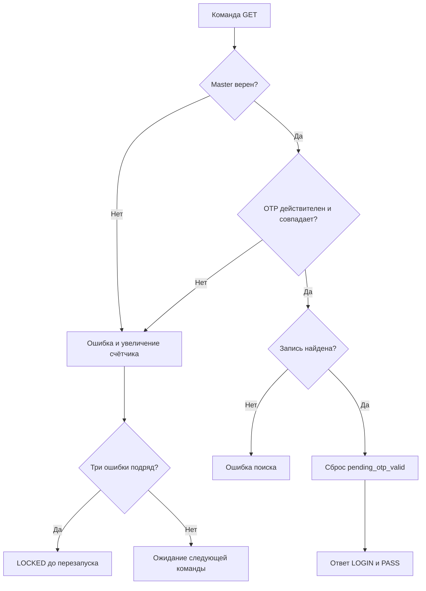

### 6.6. Подготовка демонстрационного стенда

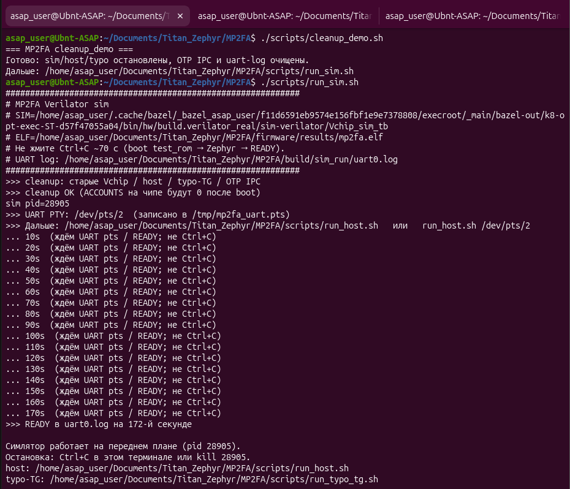

*Рисунок 1 — Запуск симуляции Earl Grey и подключение к UART/PTY.*

Скрипты управления стендом:

```text
run_sim.sh       — запуск Verilator и Zephyr/MP2FA
run_host.sh      — запуск интерактивного клиента
run_typo_tg.sh   — запуск демонстрационного канала OTP
cleanup_demo.sh  — очистка после демонстрации
```

**Порядок запуска:**

1. Запустить симуляцию через `run_sim.sh` и проверить появление сообщения `READY`.
2. Открыть второй терминал с `typo_tg.py`; выбрать аккаунт, например `bind QWERTY`.
3. Запустить `host_client.py` через `run_host.sh` и подключиться к PTY, созданному симулятором.
4. Выполнять команды через меню клиента, наблюдая ответы целевой прошивки.
5. После демонстрации завершить процессы и выполнить предусмотренную проектом очистку.


### 6.7. Практический сценарий №1 — регистрация аккаунта

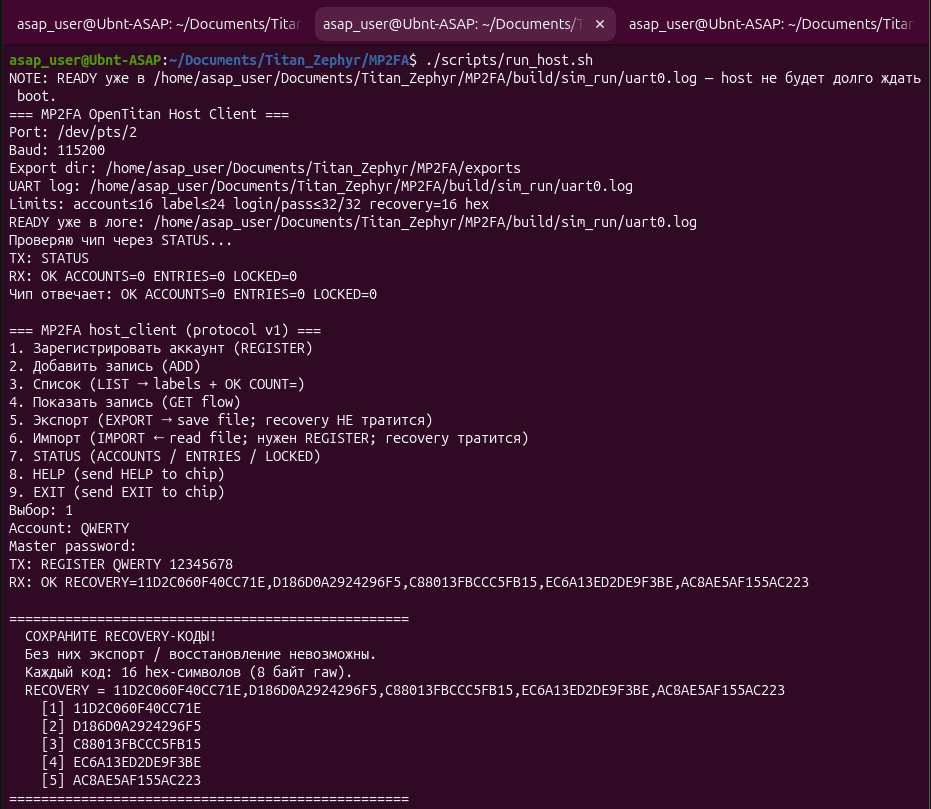

*Рисунок 2 — Регистрация аккаунта и получение тестовых recovery-кодов.*

Сначала в хост-клиенте выбирается регистрация (`REGISTER`). В демонстрации используется аккаунт `QWERTY` с тестовым мастер-паролем. Сервис создаёт аккаунт в моделируемом vault и возвращает ответ `OK RECOVERY=...` с пятью recovery-кодами.

**Что проверяется:** регистрация обрабатывается целевой прошивкой; recovery-коды генерируются в контуре симуляции, а хост отображает полученный ответ. Не следует публиковать действительные мастер-пароли и recovery-коды в открытом репозитории.

### 6.8. Практический сценарий №2 — добавление записи и просмотр списка

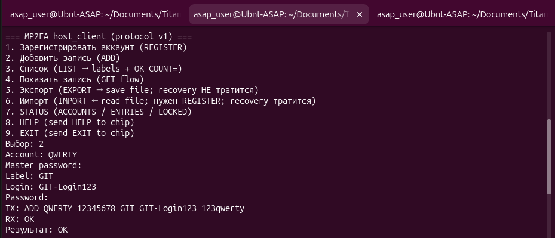

*Рисунок 3 — Добавление тестовой записи через ADD.*

После регистрации в vault добавляется тестовая запись с меткой `GIT`: логин и пароль передаются клиентом по UART и сохраняются на стороне целевого сервиса. Затем вызывается `LIST`, чтобы убедиться, что метка появилась в перечне; ожидается счётчик вида `OK COUNT=n`.

**Что проверяется:** запись действительно добавлена и доступна по метке; `LIST` возвращает перечень меток, а не должен без необходимости показывать сами пароли.


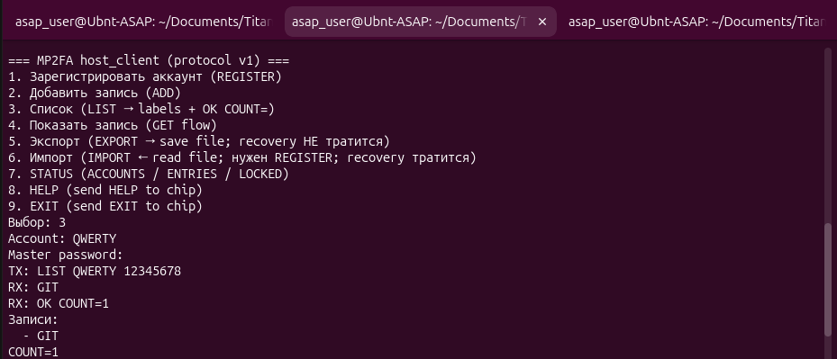

*Рисунок 4 — Проверка списка: запись доступна через LIST.*

### 6.9. Практический сценарий №3 — получение секрета по OTP

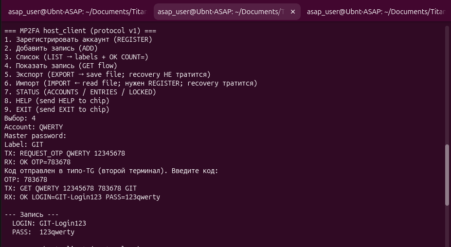

*Рисунок 5 — Получение записи через GET после проверки одноразового кода.*

Это центральная часть работы:

1. Пользователь выбирает получение секрета `GIT` в `host_client.py`.
2. Хост передаёт в прошивку `REQUEST_OTP <acc> <master>`.
3. Прошивка проверяет мастер-пароль, генерирует шестизначный OTP и возвращает `OK OTP=######`.
4. Хост публикует полученный код в `/tmp/mp2fa_otp/<account>.otp`.
5. `typo_tg.py` во втором терминале показывает этот код. В описании демо используется привязка `bind QWERTY` и отслеживание последовательности (`seq`).
6. Пользователь вводит OTP в хост-клиенте, который отправляет `GET <acc> <master> <otp> GIT`.
7. Целевой сервис проверяет оба фактора, возвращает `OK LOGIN=... PASS=...` и аннулирует OTP.

**Контрольные проверки:** неверный мастер-пароль отклоняется; неверный OTP отклоняется; повторное использование успешно применённого OTP не разрешается; при трёх последовательных ошибках срабатывает блокировка. Последняя проверка **не должна выполняться на основном наборе тестовых записей без учёта того, что перезапуск очищает RAM**.

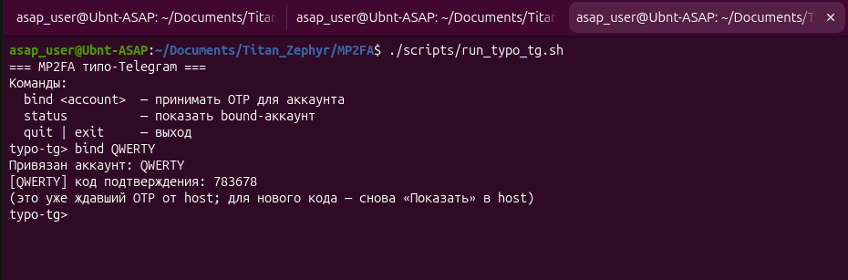

*Рисунок 6 — Отображение тестового OTP в демонстрационном канале typo-TG.*

### 6.10. Практический сценарий №4 — экспорт шифротекста

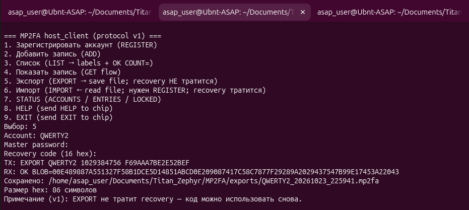

*Рисунок 7 — Команда EXPORT и сохранение файла контейнера.*

При вызове `EXPORT` сервис проверяет мастер-пароль и recovery-код, формирует зашифрованный контейнер с использованием **программного AES-256-GCM** и возвращает представление `BLOB`. Хост сохраняет результат в `exports/*.mp2fa` без расшифровки. Recovery-код при экспорте не расходуется.

**Что проверяется:** экспортируемый файл содержит шифротекст, а не открытые поля `login/password`; файл создаётся на стороне хоста. Возможность восстановить данные с помощью `IMPORT` в демонстрационный сценарий **не входила**.

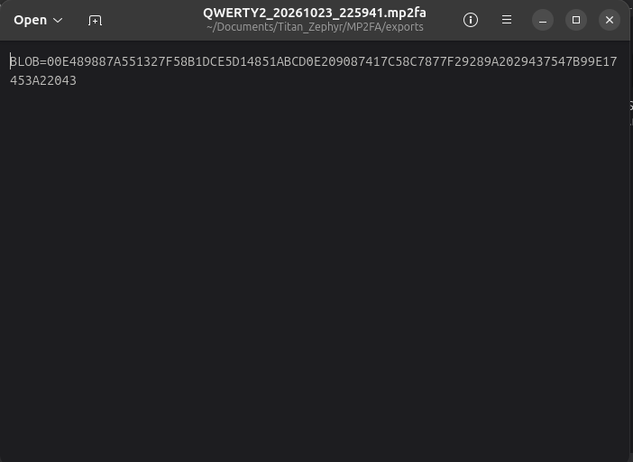

*Рисунок 8 — Просмотр экспортированного файла: на экране шифрованный BLOB.*

### 6.11. Практический сценарий №5 — статус и завершение

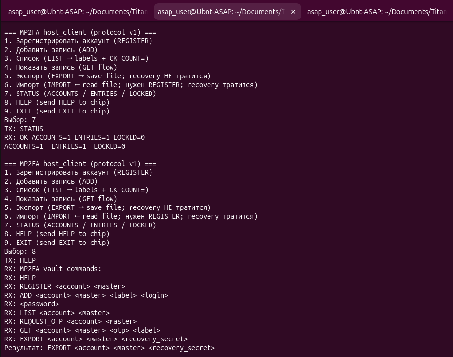

*Рисунок 9 — Вывод STATUS и перечня доступных команд HELP.*

Команда `STATUS` используется для проверки состояния сервиса, после чего демонстрация завершается через `EXIT`. Для дополнительной проверки можно наблюдать запуск и ответы в логе UART0/PTY. Если `READY` не появился, сначала проверяют запуск симуляции, загрузку прошивки и фактический PTY, а не поведение OTP.

## 7. Результаты практической работы

На рисунках 1–9 показаны запуск стенда, регистрация, добавление и просмотр записей, подтверждение OTP, выдача секрета, экспорт и запрос статуса. Ответ `OK LOGIN=... PASS=...` показывает получение записи через открытый UART; этот канал не обеспечивает конфиденциальность.

**Критерии успешного выполнения:** сервис запускается; команды обрабатываются последовательно; без валидного OTP доступ к `GET` отклоняется; использованный OTP не принимается повторно; файл экспорта содержит зашифрованный контейнер, а не список открытых паролей.

## 8. Ограничения прототипа

| Ограничение текущего стенда | Техническое следствие |
|---|---|
| Vault размещён в RAM симуляции и теряется после рестарта | Данные не сохраняются между запусками |
| Для AES/SHA используется программная реализация | Аппаратные криптоблоки OpenTitan не задействованы |
| Используется тестовый источник случайности | Стойкость случайных значений не гарантирована |
| UART между хостом и моделью не защищён | Команды и ответы передаются открытым текстом |
| `typo_tg.py` лишь имитирует отдельный канал | Независимая доставка OTP не реализована |
| Импорт экспортированного контейнера не демонстрировался | Восстановление из экспорта не подтверждено |

**Безопасность:** не используйте в учебной программе настоящие пароли, токены и recovery-фразы. Файл экспорта с тестовыми данными также не следует считать защищённым без отдельной проверки реализации.

## 9. Вывод

Создан и продемонстрирован учебный программный комплекс, позволяющий исследовать хранение учётных данных и проверку двух факторов в связке OpenTitan + Zephyr. Работа показывает архитектурное разделение хоста и целевого сервиса и одновременно выявляет существенные ограничения симуляционного прототипа.

## 10. Связанные материалы

- [Лабораторная №6 — синхронизация OpenTitan и Zephyr](../06-synchronization/README.md)
- [Общая теория: архитектура Earlgrey](../../../opentitan-theory/02-architecture.md)
- [Общая теория: периферийные устройства](../../../opentitan-theory/05-peripherals.md)
- [Общая теория: безопасность](../../../opentitan-theory/06-security.md)
- [Общая теория: моделирование](../../../opentitan-theory/07-simulation.md)
- [Официальная документация OpenTitan](https://opentitan.org/book/)
- [Zephyr: документация по ядру](https://docs.zephyrproject.org/latest/kernel/index.html)

