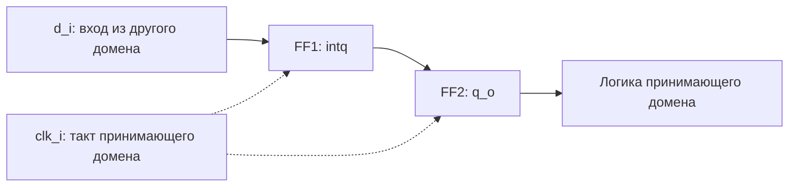
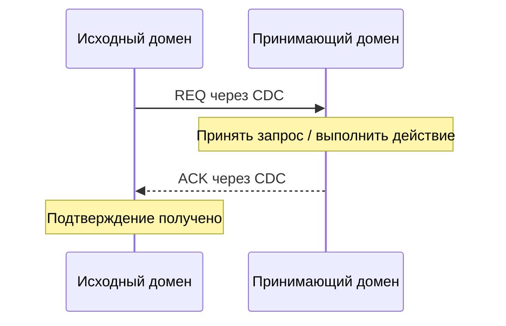
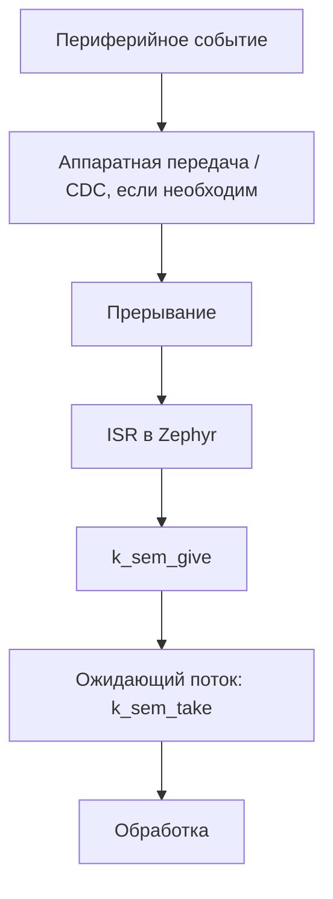

# Лабораторная работа №6 — Синхронизация в OpenTitan и Zephyr

> **Направление:** OpenTitan + Zephyr · **Стенд:** Earl Grey (Verilator) + Zephyr 3.7  

[← Все лабораторные Zephyr](../../README.md) · [← Лабораторная №5: MP2FA](../05-mp2fa/README.md)

## 1. Аннотация

В этой работе исследуются **два принципиально разных уровня синхронизации**. На аппаратном уровне OpenTitan решается задача безопасного переноса сигналов между тактовыми доменами (clock-domain crossing, CDC). На уровне Zephyr решается задача координации потоков и обработчиков прерываний. Работа объясняет, почему ни один из этих механизмов не заменяет другой, и как исследовать их поведение по исходному RTL, журналам и временным диаграммам.

## 2. Цель и задачи

**Цель:** изучить принципы аппаратной и программной синхронизации на стенде OpenTitan + Zephyr и освоить диагностику их работы.

1. Изучить понятие тактового домена и причины метастабильности.
2. Разобрать структуру двухтриггерного синхронизатора `prim_flop_2sync`.
3. Рассмотреть передачу события через `prim_sync_reqack`.
4. Исследовать примитивы Zephyr `k_sem`, `k_mutex`, `k_event` и роль планировщика.
5. Сопоставить модель обработки IRQ с переходами между аппаратурой и потоками.
6. Научиться отделять факты, наблюдаемые в логах/волнах, от теоретической модели.

## 3. Два уровня синхронизации

| Вопрос | OpenTitan (аппаратура) | Zephyr (ОС) |
|---|---|---|
| **Что синхронизируется?** | Уровни и события между тактовыми доменами | Потоки, задачи и обработчики прерываний |
| **Основная проблема** | Метастабильность, пропуск импульсов, некорректный перенос данных | Гонки, некорректное ожидание, блокировки |
| **Механизмы** | `prim_flop_2sync`, `prim_sync_reqack`, FIFO | `k_sem`, `k_mutex`, `k_event` |
| **Результат** | Сигнал безопасно воспринимается в принимающем домене с конечной вероятностью отказа | События и ресурсы координируются между выполняющимися контекстами |

> Синхронизатор не гарантирует абсолютного отсутствия метастабильности: он снижает вероятность её распространения до крайне малой при корректных временных параметрах и условиях применения.

## 4. Аппаратный уровень: clock-domain crossing

### 4.1. Тактовые домены и метастабильность

Разные части системы Earl Grey используют тактовые сигналы с различными частотами и режимами. Асинхронный вход может измениться рядом с фронтом такта приёмника. Нарушение времени установки или удержания (`setup/hold`) может приводить к метастабильному состоянию первого регистра; обычная логика не должна напрямую потреблять его выход.

### 4.2. `prim_flop_2sync`



Оба триггера работают от `clk_i` **принимающего** домена. Первый регистр получает потенциально асинхронное значение; второй предоставляет первому дополнительное время для разрешения метастабильности.

| Сигнал / регистр | Назначение |
|---|---|
| `d_i` | Вход из исходного/асинхронного домена |
| `d_o` | Вспомогательный узел задержки в указанной модели симуляции (не путать с обязательным аппаратным регистром) |
| `intq` | Значение после первого триггера |
| `q_o` | Выход второго триггера для логики приёмника |
| `clk_i`, `rst_ni` | Такт и сброс принимающего домена |

**Наблюдение:** новый устойчивый уровень появляется на `q_o` после прохождения двух стадий. Конкретное время от изменения `d_i` до наблюдения `q_o` зависит от фазы входного сигнала и конфигурации симуляции. Узкие импульсы могут быть пропущены, поэтому двухтриггерный синхронизатор уровня нельзя считать универсальным способом переноса события.

### 4.3. `prim_sync_reqack` — передача события

Для событий используется схема запроса/подтверждения (handshake): источник сохраняет запрос до подтверждения от приёмника. В протоколе рассматриваются сигналы `src_req_i`, `src_ack_o`, `dst_req_o`, `dst_ack_i` и автоматы `src_fsm_q`, `dst_fsm_q`.



Это концептуальная схема: точное поведение подтверждения, возврата уровней и сбросов зависит от режима и реализации `prim_sync_reqack`. Особого внимания требуют асимметричные сбросы и различия RZ/NRZ.

### 4.4. Другие CDC-примитивы

`prim_pulse_sync` применяется для переноса импульсов, `prim_rst_sync` — для синхронизации сброса, `prim_fifo_async` — для передачи потоков данных между доменами. **Многобитную шину нельзя корректно синхронизировать набором независимых `2sync` без анализа согласованности данных.**

## 5. Программный уровень: Zephyr

### 5.1. Семафор `k_sem`

Семафор предоставляет счётчик доступных разрешений. Операция `k_sem_take()` забирает разрешение либо блокирует поток при ожидании, если счётчик равен нулю; `k_sem_give()` увеличивает счётчик с учётом заданного предела и может пробудить ожидающий поток.

```c
#include <zephyr/kernel.h>

K_SEM_DEFINE(event_sem, 0, 1);

/* Контекст, сообщающий о событии (например, ISR при допустимых условиях): */
void signal_event(void)
{
    k_sem_give(&event_sem);
}

/* Контекст потока: */
void worker(void)
{
    while (true) {
        if (k_sem_take(&event_sem, K_FOREVER) == 0) {
            /* Обработать событие */
        }
    }
}
```

Это **иллюстративный пример**, а не код из прошивки MP2FA. В ISR нельзя блокироваться на `k_sem_take()` с ненулевым временем ожидания.

### 5.2. Выбор объекта синхронизации

| Примитив | Для чего подходит |
|---|---|
| `k_sem` | Сигнал о событии или счётный ресурс, включая передачу события от ISR к потоку |
| `k_mutex` | Взаимное исключение между потоками, защита критической секции |
| `k_event` | Ожидание комбинаций флагов событий |
| `k_condvar` | Ожидание условия вместе с mutex |

## 6. Как аппаратная и программная синхронизация взаимодействуют

В типовом *проектном сценарии* событие периферии проходит аппаратный путь до контроллера прерываний; обработчик в Zephyr фиксирует событие и может вызвать `k_sem_give()`, после чего ожидающий поток продолжает работу.



Схема `ISR → k_sem` описывает типичный способ передачи события из обработчика прерывания в поток. В UART-пути MP2FA семафор как обязательный элемент не используется.

## 7. Отладка и анализ

### 7.1. Журналы симуляции

| Источник | Что помогает проверить |
|---|---|
| `sim.stdout` | Запуск модели, диагностические сообщения, ошибки загрузки |
| `uart0.log` / PTY | Сообщения загрузки Zephyr, `READY`, команды и ответы |

### 7.2. Временные диаграммы

При наличии сгенерированных файлов **FST/VCD** удобно использовать GTKWave. Найдите `d_i`, `intq`, `q_o` и такт приёмника. Для handshake дополнительно исследуйте сигналы запросов, подтверждений и состояния автоматов (`src_fsm_q`, `dst_fsm_q`).

**Алгоритм анализа:**

1. Определить частоту и фронты такта **принимающего** домена.
2. Найти изменение входного сигнала и отметить моменты изменения `intq` и `q_o`.
3. Проверить задержку между стадиями синхронизатора.
4. Для handshake сопоставить REQ, ACK и последовательность состояний.
5. Соотнести события в RTL с логами ПО, не выдавая совпадение времён без синхронизации шкал за доказательство причинности.

### 7.3. Типовые симптомы

| Симптом | Направление проверки |
|---|---|
| Не появляется `READY` | Запуск симулятора, загрузка ELF, ошибки meminit |
| Некорректный вывод UART | PTY, настройки терминала, формат/фрагментация данных |
| Короткий импульс не виден в другом домене | Способ переноса события, длительность импульса |
| Несогласованные биты шины | Handshake, FIFO, Gray-код для подходящих типов данных |
| Зависание REQ/ACK | Состояния FSM и последовательность сбросов |
| Поток не просыпается | Путь ISR, вызов `k_sem_give()`, состояние семафора и приоритеты |

## 8. Порядок практического исследования

Последовательность анализа аппаратной и программной синхронизации:

### 8.1. Проверка двухтриггерного синхронизатора

1. Найти в RTL экземпляр `prim_flop_2sync` и определить тактовый домен приёмника (`clk_i`).
2. При наличии FST/VCD открыть временную диаграмму и вывести `d_i`, `intq`, `q_o`, `clk_i`, `rst_ni`.
3. Отметить фронт `clk_i`, на котором входное значение попадает в `intq`, и следующий фронт, на котором оно появляется на `q_o`.
4. Сопоставить наблюдение с двухступенчатой схемой; помнить, что RTL-симуляция сама по себе не моделирует аналоговую физику метастабильности.
5. Записать номер временного участка и приложить **реальную** диаграмму, если она была сохранена.

### 8.2. Проверка рукопожатия REQ/ACK

1. Найти экземпляр `prim_sync_reqack` и обе границы тактовых доменов.
2. Проследить последовательность `src_req_i`, `dst_req_o`, `dst_ack_i`, `src_ack_o` и состояний `src_fsm_q` / `dst_fsm_q`.
3. Проверить, что источник не начинает новый запрос до завершения предыдущего согласно выбранному режиму протокола.
4. Отдельно изучить поведение схемы при сбросе доменов, если оно реально проверяется экспериментом.

### 8.3. Анализ синхронизации потоков Zephyr

В примере из раздела 5 `k_sem_give()` сигнализирует о событии, а ожидающий поток продолжает выполнение после `k_sem_take()`. Пример не относится к исходному коду MP2FA.

### 8.4. Контрольные наблюдения

| Проверка | Источник данных | Ожидаемое поведение | Фактические данные |
|---|---|---|---|
| Уровень проходит через две ступени | RTL и FST/VCD | `intq` изменяется раньше `q_o` | Осциллограмма не приложена |
| REQ достигает приёмника и возвращает ACK | RTL и FST/VCD | Порядок запрос–подтверждение | Трасса не приложена |
| `k_sem_give()` пробуждает ожидание | Тестовое приложение/лог Zephyr | Парное событие `give/take` | Пример программного механизма |
| UART-путь MP2FA принимает команды | UART/PTY | Ответы сервиса на запросы | Результаты в лабораторной №5 |

## 9. Результаты

Разобраны двухступенчатый синхронизатор `prim_flop_2sync`, передача событий по `prim_sync_reqack` и координация потоков через `k_sem`. Описаны диагностические признаки в RTL и UART-журналах. Измерения задержек и экспериментальные FST/VCD-осциллограммы в отчёт не включены.

## 10. Вывод

Синхронизация аппаратных сигналов между тактовыми доменами и синхронизация программных потоков решают разные задачи. Двухступенчатые CDC-синхронизаторы и handshake-протоколы позволяют переносить данные и события между аппаратными доменами. Примитивы Zephyr управляют ожиданием и пробуждением программных контекстов. Совместный анализ RTL, журналов и временных диаграмм необходим для диагностики работы системы.

## 11. Связанные материалы и источники

- [Лабораторная №5 — разработка MP2FA](../05-mp2fa/README.md)
- [Теория: архитектура Earlgrey](../../../opentitan-theory/02-architecture.md)
- [Теория: периферийные устройства](../../../opentitan-theory/05-peripherals.md)
- [Теория: моделирование и отладка](../../../opentitan-theory/07-simulation.md)
- [OpenTitan: документация](https://opentitan.org/book/)
- [Zephyr: семафоры](https://docs.zephyrproject.org/latest/kernel/services/synchronization/semaphores.html)

